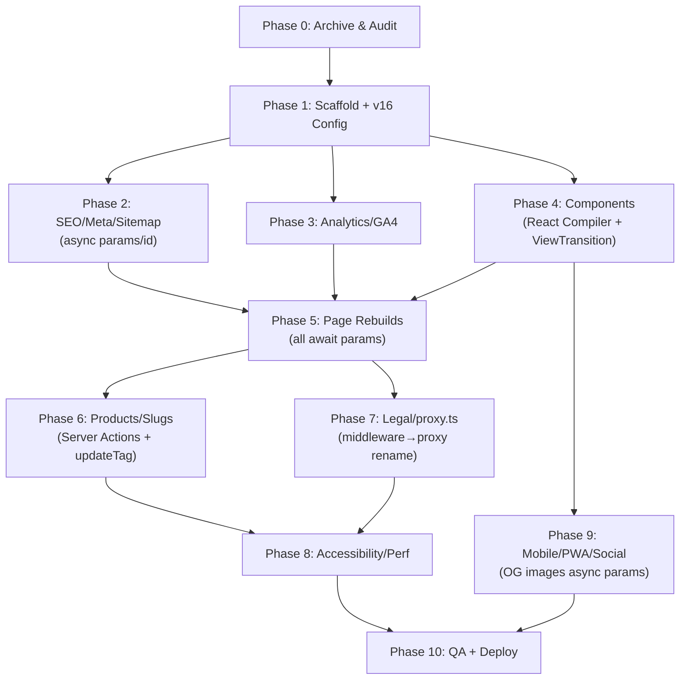

# Kingsland Distributors Ltd — Complete Next.js 16 Rebuild Plan
### Version 2.0 · September 2026 · Based on Official Next.js 16.3.5 Upgrade Docs

> [!IMPORTANT]
> This plan was updated after reading the **official Next.js 16 upgrade guide** at [nextjs.org/docs/app/guides/upgrading/version-16](https://nextjs.org/docs/app/guides/upgrading/version-16) (v16.3.5, last updated 25 August 2026). Next.js 16 is **real and released**. Every breaking change and new API that affects this project is documented below with the required action.

---

## 📋 Master Checklist

```
PHASE 0  ── Archive & Pre-flight Audit
PHASE 1  ── Project Scaffold & Core Infrastructure
PHASE 2  ── SEO, Meta, Structured Data & Crawlability
PHASE 3  ── Analytics, Tracking & Search Console
PHASE 4  ── Component Library & Design System
PHASE 5  ── Page Rebuilds (all 10 pages)
PHASE 6  ── Product Catalogue, Dynamic Routes & Enquiry System
PHASE 7  ── Legal Pages, Cookie Consent & Compliance
PHASE 8  ── Accessibility, Forms, Broken Links & Performance
PHASE 9  ── Mobile, PWA & Social Share
PHASE 10 ── QA, Pre-launch Checks & Deployment
```

---

## 🆕 Next.js 16 Breaking Changes — Full Impact Table

These are confirmed changes from the official v16.3.5 upgrade guide and their effect on this build:

| Change | Impact | Action |
|---|---|---|
| **Node.js 20.9+ required** (18 dropped) | Verify deployment environment | ✅ Vercel auto-selects Node 20 |
| **Turbopack is now the default** for both `next dev` AND `next build` | No `--turbopack` flag needed; custom Webpack configs break builds | ✅ Remove flag from scripts |
| **`turbopack` config moves to top-level** of `next.config.ts` | `experimental.turbopack` is now just `turbopack` | 🔴 Restructure `next.config.ts` |
| **Turbopack Filesystem Caching** (on by default) | Faster restarts across both dev and build — no config needed | ✅ Keep default |
| **`middleware.ts` renamed to `proxy.ts`** | Age gate and any middleware must use new filename AND function name | 🔴 Rename file; rename export to `proxy` |
| **Async Request APIs — sync access fully removed** | `params`, `searchParams`, `cookies()`, `headers()`, `draftMode()` MUST be `await`ed — no synchronous compat layer | 🔴 Every dynamic page/layout needs `await params` |
| **`sitemap.ts` `id` param is now a Promise** | `sitemap({ id })` must do `const resolvedId = await id` | 🔴 Update dynamic sitemap |
| **OG/icon image generators: `params` and `id` are Promises** | `opengraph-image.tsx` generators must `await params` and `await id` | 🔴 Update OG image generators |
| **React 19.2 included** | New `View Transitions`, `useEffectEvent`, `Activity` APIs available | 🟡 Use View Transitions for page nav animations |
| **React Compiler stable** (opt-in via `reactCompiler: true`) | Auto-memoizes components — eliminates need for manual `React.memo`, `useMemo`, `useCallback` | 🟡 Enable — simplifies the entire component library |
| **`revalidateTag` now requires second argument** | `revalidateTag('tag')` → `revalidateTag('tag', 'max')` | 🔴 Update all Server Action cache invalidations |
| **New `updateTag` API** (Server Actions only) | Instant read-your-writes cache refresh — better than `revalidateTag` for form submissions | 🟡 Use in contact + enquiry Server Actions |
| **New `refresh` API** | Refreshes client router from a Server Action | 🟡 Use after form submissions |
| **`cacheLife` / `cacheTag` stable** (no `unstable_` prefix) | Import directly from `next/cache` | ✅ Clean imports |
| **`cacheComponents: true`** replaces `experimental.ppr` | PPR model changed — not using PPR so no action | ➖ N/A |
| **`next/image`: `minimumCacheTTL` → 4 hours** (was 60s) | Product images cached longer automatically | ✅ Keep default — correct for products |
| **`next/image`: `qualities` → `[75]` only** | Only quality 75 by default; must declare others explicitly | ✅ Single quality is fine for product images |
| **`next/image`: `imageSizes` drops `16`** | No 16px images in this project | ➖ N/A |
| **`next/image`: max redirects → 3** (was unlimited) | Unsplash hero images go through CDN — no redirects expected | ✅ Keep default |
| **`images.domains` deprecated** | Must use `remotePatterns` for Unsplash | ✅ Already planned correctly |
| **`next lint` command removed** | Must call ESLint CLI directly in scripts | 🔴 Update `package.json` scripts |
| **ESLint Flat Config** is now default | Must use `eslint.config.mjs` (not `.eslintrc`) | 🔴 Use flat config on scaffold |
| **`serverRuntimeConfig` / `publicRuntimeConfig` removed** | Not used — environment variables are the correct pattern | ➖ N/A |
| **Scroll behavior override removed** | Next.js no longer overrides `scroll-behavior: smooth` during nav | 🟡 Add `data-scroll-behavior="smooth"` to `<html>` if desired |
| **`next build` removes `size`/`First Load JS` metrics** | Use Lighthouse and Vercel Analytics instead | ✅ Already in QA plan |
| **`next dev` / `next build` use separate output dirs** | `.next/dev` for dev; `.next` for production — no action needed | ✅ Auto-handled |
| **`unstable_rootParams` removed** | Use `next/root-params` instead | ➖ N/A (not used) |
| **AGENTS.md should be generated** | Run `npx @next/codemod@canary agents-md` for AI agent grounding | 🟡 Run in Phase 0 |
| **Parallel Routes need explicit `default.js`** | Not using parallel routes in this project | ➖ N/A |

---

## ⚡ Critical Pre-Existing Bugs (Fix During Build)

| # | Bug | Location | Fix |
|---|---|---|---|
| 1 | `total` is `undefined` | `CheckoutPage` line 1544 | Add `price` to products; compute total with `useMemo` |
| 2 | JW Blue Label is **4.26 MB** | `src/images/` | Compress to WebP ≤150 KB before moving to `public/` |
| 3 | All `alert()` calls | Cart, wishlist, form | Replace with `react-hot-toast` (already installed) |
| 4 | `React.memo` broken | All pages defined inside parent scope | Split into separate files — fixed by architecture change |
| 5 | `suo.js` — dead file | `src/suo.js` | Delete immediately |
| 6 | No price on products | `products[]` array | Add `price` (UGX), `priceFormatted`, `availability` |
| 7 | Category casing mismatch | "Whisky" vs "whisky" | Normalise all to lowercase slug |
| 8 | Contact form fires `alert()` | `ContactPage` | Wire to Server Action + `updateTag` + toast |
| 9 | Social icons have no `href` | Footer | Add real social URLs |
| 10 | `robots.txt` has no Sitemap directive | `public/robots.txt` | Now auto-generated via `app/robots.ts` |

---

---

# PHASE 0 — Archive & Pre-flight Audit
**⏱ Estimated: 2–3 hours**

### 0.1 — Source Code Archive
- [ ] `git tag v0.1.0-cra-baseline && git push origin v0.1.0-cra-baseline`
- [ ] ZIP snapshot stored in `archive/cra-baseline-YYYY-MM-DD.zip`
- [ ] Export and document current Search Console configuration (queries, indexing, verification codes)
- [ ] Screenshot all current pages on desktop + mobile

### 0.2 — Asset Inventory
- [ ] Document all 32 product images with file sizes (JW Blue Label = **4.26 MB critical**)
- [ ] Export all product data to `lib/products.json` (name, category, origin, ABV, description)

### 0.3 — Technical Audit (Baseline)
- [ ] Run **Google PageSpeed Insights** on live site → record LCP, CLS, INP, TTFB
- [ ] Run **Lighthouse** → record Performance, Accessibility, Best Practices, SEO scores
- [ ] Check **Google Search Console** for indexed pages, Coverage errors, top queries (investigate `vicland distributors` impressions)
- [ ] Run Screaming Frog crawl → export all URLs, status codes, meta titles, H1s
- [ ] Test all 7 routes for broken links; test WhatsApp checkout end-to-end
- [ ] Document findings in `docs/audit-baseline.md`

### 0.4 — GSC & Analytics Preservation
- [ ] Export historical GSC data (last 16 months)
- [ ] Confirm GA property ID or note this is a fresh GA4 setup
- [ ] **Do NOT** change DNS or GSC settings until Phase 10

### 0.5 — Next.js 16 Agent Setup (New — v16)
- [ ] After scaffolding, run:
  ```bash
  npx @next/codemod@canary agents-md
  ```
- [ ] This generates `AGENTS.md` pointing at bundled Next.js 16 docs in `node_modules/next/dist/docs/`
- [ ] Commit `AGENTS.md` with the project — keeps AI tooling (including this agent) grounded in v16-specific docs

---

---

# PHASE 1 — Project Scaffold & Core Infrastructure
**⏱ Estimated: 3–4 hours**

### 1.1 — Scaffold Next.js 16 Project

```bash
npx create-next-app@latest kingsland-next \
  --typescript \
  --tailwind \
  --app \
  --src-dir \
  --import-alias "@/*"
```

> [!NOTE]
> Do **not** pass `--turbopack` — in Next.js 16, Turbopack is the **default** for both `next dev` and `next build`. The flag is no longer needed.

### 1.2 — Install Dependencies

```bash
pnpm add next@latest react@latest react-dom@latest
pnpm add lucide-react react-hot-toast zustand \
         @radix-ui/react-dialog @radix-ui/react-scroll-area \
         next-themes clsx tailwind-merge \
         react-hook-form zod @hookform/resolvers \
         sharp

pnpm add -D @types/node @types/react @types/react-dom \
            typescript \
            babel-plugin-react-compiler \
            prettier prettier-plugin-tailwindcss \
            eslint @eslint/eslintrc
```

> [!IMPORTANT]
> `babel-plugin-react-compiler` is required to enable the React Compiler in Next.js 16. Install as a dev dependency.

### 1.3 — `package.json` Scripts (v16 Correct Format)

```json
{
  "scripts": {
    "dev": "next dev",
    "build": "next build",
    "start": "next start",
    "lint": "eslint src/",
    "typegen": "next typegen"
  }
}
```

> [!WARNING]
> **`next lint` has been removed in Next.js 16.** The `lint` script must call `eslint` directly. Also note `next build` **no longer runs linting** automatically.

> [!NOTE]
> `next typegen` is a new v16 command that auto-generates `PageProps`, `LayoutProps`, and `RouteContext` type helpers for all dynamic routes — run this whenever you add or rename a route.

### 1.4 — `next.config.ts` (v16 Correct Format)

```typescript
import type { NextConfig } from 'next'

const nextConfig: NextConfig = {
  // ✅ React Compiler — stable in Next.js 16, opt-in
  // Automatically memoizes components; eliminates React.memo, useMemo, useCallback
  reactCompiler: true,

  // ✅ Turbopack top-level config (moved OUT of experimental in v16)
  turbopack: {
    // Add custom rules here if needed
  },

  images: {
    // ✅ remotePatterns (images.domains is deprecated in v16)
    remotePatterns: [
      {
        protocol: 'https',
        hostname: 'images.unsplash.com',
      },
    ],
    formats: ['image/avif', 'image/webp'],
    // minimumCacheTTL defaults to 4 hours in v16 — good for product images
    // qualities defaults to [75] in v16 — appropriate for product images
  },

  reactStrictMode: true,
}

export default nextConfig
```

> [!WARNING]
> If any dependency adds a custom `webpack` configuration, `next build` will **fail** in v16 because Turbopack is now the default for builds. Fix by migrating the webpack config to Turbopack options, or use `next build --webpack` as a temporary workaround.

### 1.5 — ESLint Flat Config (v16 Required)

Next.js 16 defaults to ESLint Flat Config. Use `eslint.config.mjs` — **not** `.eslintrc`:

```javascript
// eslint.config.mjs
import { dirname } from 'path'
import { fileURLToPath } from 'url'
import { FlatCompat } from '@eslint/eslintrc'

const __filename = fileURLToPath(import.meta.url)
const __dirname = dirname(__filename)
const compat = new FlatCompat({ baseDirectory: __dirname })

const eslintConfig = [
  ...compat.extends('next/core-web-vitals', 'next/typescript'),
]

export default eslintConfig
```

### 1.6 — Folder Structure

```
src/
├── app/
│   ├── layout.tsx                    ← Root layout: Nav + Footer + Providers
│   ├── page.tsx                      ← Home (/)
│   ├── globals.css
│   ├── products/
│   │   ├── page.tsx                  ← All Products (/products)
│   │   └── [slug]/
│   │       ├── page.tsx              ← Individual product (/products/johnnie-walker-blue-label)
│   │       └── opengraph-image.tsx   ← Per-product OG image generator
│   ├── categories/
│   │   └── [slug]/
│   │       └── page.tsx              ← Category page (/categories/whisky)
│   ├── about/page.tsx
│   ├── contact/page.tsx
│   ├── cart/page.tsx
│   ├── wishlist/page.tsx
│   ├── checkout/page.tsx
│   ├── faq/page.tsx
│   ├── privacy-policy/page.tsx
│   ├── terms/page.tsx
│   ├── sitemap.ts                    ← Auto-generated, uses async id pattern (v16)
│   ├── robots.ts                     ← Auto-generated
│   └── not-found.tsx                 ← Custom 404
│
├── components/
│   ├── layout/
│   │   ├── Navigation.tsx
│   │   ├── Footer.tsx
│   │   ├── MobileBottomNav.tsx
│   │   └── AgeGate.tsx
│   ├── ui/
│   │   ├── Button.tsx
│   │   ├── Badge.tsx
│   │   ├── Modal.tsx
│   │   ├── CookieBanner.tsx
│   │   └── SkipToContent.tsx
│   ├── home/
│   │   ├── HeroSection.tsx
│   │   ├── FeaturedProducts.tsx
│   │   └── ValueProps.tsx
│   ├── products/
│   │   ├── ProductCard.tsx
│   │   ├── ProductGrid.tsx
│   │   ├── ProductFilters.tsx
│   │   ├── SearchBar.tsx
│   │   ├── QuickViewModal.tsx
│   │   ├── EnquiryForm.tsx
│   │   └── CategoryNav.tsx
│   └── cart/
│       ├── CartItem.tsx
│       └── CartSummary.tsx
│
├── store/
│   ├── cartStore.ts                  ← Zustand cart store
│   └── wishlistStore.ts              ← Zustand wishlist store
│
├── lib/
│   ├── products.ts                   ← Product data + slugify helper
│   ├── categories.ts
│   ├── analytics.ts                  ← GA4 event helpers
│   ├── metadata.ts                   ← Shared metadata builder
│   └── utils.ts                      ← cn(), slugify(), formatPrice()
│
├── actions/
│   ├── contact.ts                    ← Server Action: contact form
│   └── enquiry.ts                    ← Server Action: product enquiry
│
├── hooks/
│   ├── useCart.ts
│   ├── useWishlist.ts
│   └── useAnalytics.ts
│
└── types/
    ├── product.ts
    └── index.ts

proxy.ts                              ← Age gate (renamed from middleware.ts in v16)
AGENTS.md                             ← AI agent docs (generated by codemod)
```

> [!WARNING]
> **`middleware.ts` is renamed to `proxy.ts` in Next.js 16.** The exported function name also changes from `middleware` to `proxy`. This affects the age gate implementation.

### 1.7 — Environment Variables

```bash
# .env.local
NEXT_PUBLIC_GA_MEASUREMENT_ID=G-XXXXXXXXXX
NEXT_PUBLIC_SITE_URL=https://kingslanduganda.com
NEXT_PUBLIC_WHATSAPP_NUMBER=256706119011
CONTACT_EMAIL=kingslanddistributors.ug@gmail.com
RESEND_API_KEY=re_xxxxxxxxxxxx
```

> [!NOTE]
> `serverRuntimeConfig` and `publicRuntimeConfig` are **removed** in Next.js 16. Environment variables accessed via `process.env` are the only supported pattern. `NEXT_PUBLIC_` prefix for client-accessible values. Server-only values accessed directly in Server Components.

---

---

# PHASE 2 — SEO, Meta, Structured Data & Crawlability
**⏱ Estimated: 4–5 hours**

### 2.1 — Global Metadata (Root Layout)

```typescript
// src/app/layout.tsx
export const metadata: Metadata = {
  metadataBase: new URL('https://kingslanduganda.com'),
  title: {
    default: 'Kingsland Distributors | Premium Spirits in Uganda',
    template: '%s | Kingsland Distributors Uganda',
  },
  description: "Uganda's premier distributor of premium spirits, whisky, cognac, champagne, and wines. Based in Kampala's Industrial Area. Order via WhatsApp.",
  keywords: ['spirits distributor uganda', 'premium whisky kampala', 'cognac uganda', 'kingsland distributors'],
  openGraph: {
    type: 'website',
    locale: 'en_UG',
    url: 'https://kingslanduganda.com',
    siteName: 'Kingsland Distributors',
    images: [{ url: '/images/og/kingsland-og-default.jpg', width: 1200, height: 630 }],
  },
  twitter: { card: 'summary_large_image', site: '@KingslandUG' },
  robots: { index: true, follow: true },
  verification: { google: 'YOUR_GSC_VERIFICATION_CODE' },
}
```

### 2.2 — Dynamic Product Pages — Async `params` (v16 Breaking Change)

> [!WARNING]
> In Next.js 16, `params` in `page.tsx`, `layout.tsx`, and image generators are **Promises** — synchronous access is fully removed. Every dynamic page MUST `await params`.

```typescript
// src/app/products/[slug]/page.tsx — v16 CORRECT pattern

// Use next typegen to auto-generate this type:
// Run: pnpm typegen
export default async function ProductPage(props: PageProps<'/products/[slug]'>) {
  const { slug } = await props.params  // ← MUST await in Next.js 16
  const product = getProductBySlug(slug)
  // ...
}

export async function generateMetadata(props: PageProps<'/products/[slug]'>): Promise<Metadata> {
  const { slug } = await props.params  // ← MUST await here too
  const product = getProductBySlug(slug)
  return {
    title: `${product.name} — Buy in Uganda`,
    description: `${product.description} Available from Kingsland Distributors, Kampala.`,
    alternates: { canonical: `https://kingslanduganda.com/products/${slug}` },
  }
}
```

Run `pnpm typegen` after creating any dynamic route to generate `PageProps<'/products/[slug]'>` type helpers automatically.

### 2.3 — OG Image Generators — Async `params` and `id` (v16 Breaking Change)

```typescript
// src/app/products/[slug]/opengraph-image.tsx — v16 CORRECT pattern
export default async function Image({ params, id }: {
  params: Promise<{ slug: string }>
  id: Promise<string>
}) {
  const { slug } = await params   // ← params is now a Promise
  const imageId = await id        // ← id is now a Promise
  const product = getProductBySlug(slug)
  // Generate OG image using ImageResponse...
}
```

### 2.4 — Dynamic Sitemap — Async `id` (v16 Breaking Change)

```typescript
// src/app/sitemap.ts — v16 CORRECT pattern for multi-page sitemaps
export async function generateSitemaps() {
  return [{ id: 0 }] // Single sitemap for this project
}

export default async function sitemap({ id }: { id: Promise<string> }) {
  const resolvedId = await id  // ← id is now a Promise in Next.js 16

  const staticPages = ['/', '/products', '/about', '/contact', '/faq', '/privacy-policy', '/terms']
  const productPages = products.map(p => ({
    url: `https://kingslanduganda.com/products/${p.slug}`,
    lastModified: new Date(),
    changeFrequency: 'monthly' as const,
    priority: 0.8,
  }))
  const categoryPages = categories.map(c => ({
    url: `https://kingslanduganda.com/categories/${c.slug}`,
    changeFrequency: 'weekly' as const,
    priority: 0.7,
  }))
  return [
    ...staticPages.map(url => ({ url: `https://kingslanduganda.com${url}`, priority: url === '/' ? 1.0 : 0.8 })),
    ...productPages,
    ...categoryPages,
  ]
}
```

### 2.5 — Dynamic `robots.ts`

```typescript
// src/app/robots.ts
export default function robots(): MetadataRoute.Robots {
  return {
    rules: [
      { userAgent: '*', allow: '/', disallow: ['/cart', '/checkout', '/wishlist', '/api/'] },
    ],
    sitemap: 'https://kingslanduganda.com/sitemap.xml',
    host: 'https://kingslanduganda.com',
  }
}
```

### 2.6 — Canonical URLs
- [ ] Every page has `alternates.canonical` in its metadata export
- [ ] Products page with active filters uses canonical pointing to base `/products` URL
- [ ] Product detail pages: canonical = `https://kingslanduganda.com/products/{slug}`

### 2.7 — JSON-LD Structured Data

**Organization schema** (root layout — every page):
```json
{
  "@context": "https://schema.org",
  "@type": "Organization",
  "name": "Kingsland Distributors Ltd",
  "url": "https://kingslanduganda.com",
  "logo": "https://kingslanduganda.com/images/kingsland-logo.png",
  "contactPoint": { "@type": "ContactPoint", "telephone": "+256757042420" },
  "address": { "@type": "PostalAddress", "streetAddress": "6th Street Industrial Area", "addressLocality": "Kampala", "addressCountry": "UG" }
}
```

**Product schema** (each `/products/[slug]`):
```json
{
  "@context": "https://schema.org",
  "@type": "Product",
  "name": "Johnnie Walker Blue Label 100cl",
  "brand": { "@type": "Brand", "name": "Johnnie Walker" },
  "offers": { "@type": "Offer", "availability": "https://schema.org/InStock", "priceCurrency": "UGX" }
}
```

**LocalBusiness schema** (Contact page) + **FAQPage schema** (FAQ page).

### 2.8 — Per-Page Metadata Table

| Page | Title | Description |
|---|---|---|
| `/` | Kingsland Distributors \| Premium Spirits Uganda | Uganda's premier distributor of Johnnie Walker, Hennessy, Moët & more. |
| `/products` | Premium Spirits Collection \| Shop Now | Browse 31+ premium spirits — whisky, cognac, champagne, vodka in Kampala. |
| `/products/[slug]` | `{product.name}` — Buy in Uganda | `{product.description}` Available from Kingsland Distributors, Kampala. |
| `/categories/[slug]` | Buy Premium `{category}` in Uganda | `{category}` selection from Kingsland Distributors. |
| `/about` | About Us \| Our Story | Founded in 2010, bringing the world's finest spirits to Uganda. |
| `/contact` | Contact Us \| Kingsland Distributors | +256 757 042 420. 6th Street Industrial Area, Kampala. |
| `/faq` | FAQs \| Kingsland Distributors | Common questions about ordering, delivery, and our product range. |
| `/privacy-policy` | Privacy Policy | How we collect and use your data. |
| `/terms` | Terms & Conditions | Our terms of sale and service. |
| `404` | Page Not Found | — (noindex) |

### 2.9 — GSC: Investigate `vicland distributors` Query
- [ ] Export all Search Console queries with impressions, filter for unexpected brand names
- [ ] Audit all page copy and meta for any text matching "vicland"
- [ ] Add brand clarification in FAQ: "We are Kingsland Distributors..."
- [ ] Ensure all page titles start with "Kingsland"

---

---

# PHASE 3 — Analytics, Tracking & Search Console
**⏱ Estimated: 3–4 hours**

### 3.1 — Google Analytics 4 Setup

```typescript
// src/components/analytics/GoogleAnalytics.tsx
'use client'
import Script from 'next/script'
const GA_ID = process.env.NEXT_PUBLIC_GA_MEASUREMENT_ID

export function GoogleAnalytics() {
  return (
    <>
      <Script src={`https://www.googletagmanager.com/gtag/js?id=${GA_ID}`} strategy="afterInteractive" />
      <Script id="ga4-init" strategy="afterInteractive">{`
        window.dataLayer = window.dataLayer || [];
        function gtag(){dataLayer.push(arguments);}
        gtag('js', new Date());
        gtag('config', '${GA_ID}', { page_path: window.location.pathname });
      `}</Script>
    </>
  )
}
```

- [ ] Only add `<GoogleAnalytics />` to `layout.tsx` after cookie consent is given (see Phase 7)
- [ ] Create GA4 property; link to Google Search Console

### 3.2 — Analytics Helper Library

```typescript
// src/lib/analytics.ts
export const analytics = {
  whatsappClick: (product?: string) => trackEvent('whatsapp_click', { product_name: product }),
  phoneDialClick: () => trackEvent('phone_dial', { phone: '+256757042420' }),
  emailClick: () => trackEvent('email_click', { email: 'kingslanddistributors.ug@gmail.com' }),
  contactFormSubmit: () => trackEvent('form_submit', { form_name: 'contact_form' }),
  enquiryFormSubmit: (product: string) => trackEvent('form_submit', { form_name: 'product_enquiry', product_name: product }),
  productView: (product: { id: number; name: string; category: string }) =>
    trackEvent('view_item', { currency: 'UGX', items: [{ item_id: product.id, item_name: product.name, item_category: product.category }] }),
  addToCart: (product: { id: number; name: string; category: string }) =>
    trackEvent('add_to_cart', { currency: 'UGX', items: [{ item_id: product.id, item_name: product.name }] }),
  categoryFilter: (category: string) => trackEvent('select_content', { content_type: 'category', content_id: category }),
  searchQuery: (query: string) => trackEvent('search', { search_term: query }),
}
```

### 3.3 — Event Tracking Map

| Event | Trigger | Component |
|---|---|---|
| `whatsapp_click` | Place Order / Enquire via WhatsApp | `CheckoutPage`, `EnquiryForm` |
| `phone_dial` | Phone number click | `ContactPage`, `Footer` |
| `email_click` | Email address click | `ContactPage`, `Footer` |
| `contact_form_submit` | Contact form success | `ContactPage` |
| `product_enquiry` | Enquiry form submitted | `EnquiryForm` |
| `view_item` | Product page load or QuickView open | `ProductPage`, `QuickViewModal` |
| `add_to_cart` | Add to Cart button click | `ProductCard` |
| `search` | Search input (debounced) | `SearchBar` |
| `select_content` | Category filter click | `ProductFilters` |
| `age_verified` | Age gate "I am 18+" click | `AgeGate` |

---

---

# PHASE 4 — Component Library & Design System
**⏱ Estimated: 4–5 hours**

### 4.1 — React Compiler Integration (v16 New)

Because `reactCompiler: true` is enabled in `next.config.ts`:

> [!TIP]
> With the React Compiler active, **remove all manual `React.memo()` wrappers, `useMemo`, and `useCallback` calls** — the compiler handles memoization automatically and more precisely. This also eliminates the broken `React.memo` issue that exists in the current CRA codebase.

- [ ] Write components naturally without memoization annotations
- [ ] The compiler will warn during build if any component breaks the Rules of React
- [ ] Expect slightly slower cold build times (React Compiler uses Babel) — this is documented behaviour

### 4.2 — View Transitions (React 19.2 — v16 New)

Next.js 16 ships with React 19.2 which includes the `ViewTransition` API:

```typescript
// Wrap navigation-triggered state changes for animated page transitions
import { ViewTransition } from 'react'

// Smooth product-to-detail page transitions, hero crossfades, etc.
```

- [ ] Use `ViewTransition` for hero section crossfade (replaces manual CSS animation)
- [ ] Use for product quick view open/close animation
- [ ] Wrap page transitions for a native-feeling mobile experience

### 4.3 — Design Tokens

```typescript
// tailwind.config.ts
theme: {
  extend: {
    colors: {
      brand: {
        gold: '#D97706',
        'gold-light': '#F59E0B',
        'gold-hover': '#B45309',
        dark: '#000000',
        surface: '#1A0A00',
      },
    },
    fontFamily: {
      serif: ['var(--font-playfair)', 'Georgia', 'serif'],
      sans: ['var(--font-inter)', 'system-ui', 'sans-serif'],
    },
  },
}
```

### 4.4 — Core UI Components

**`Button.tsx`** — Variants: `primary`, `secondary`, `ghost`, `danger`; loading state; accessible focus rings

**`ProductCard.tsx`**:
- `next/image` with `fill` layout
- Name, brand, category badge, origin, ABV, availability badge
- Wishlist toggle + Quick View trigger
- "Add to Cart" + "Enquire" buttons
- All interactions call `analytics.*`

**`QuickViewModal.tsx`** — Built with `@radix-ui/react-dialog`:
- Accessible (focus trap, ESC, ARIA)
- Image zoom
- Embedded enquiry form
- Fires `view_item` GA4 event

**`SearchBar.tsx`** — Debounced 300ms; fires `search` event; keyboard navigable

**`CookieBanner.tsx`** — Three consent tiers; GA4 only loads after analytics consent

**`SkipToContent.tsx`** — First element in `<body>`; essential for keyboard users

### 4.5 — Fonts via `next/font`

```typescript
import { Playfair_Display, Inter } from 'next/font/google'
const playfair = Playfair_Display({ subsets: ['latin'], variable: '--font-playfair' })
const inter = Inter({ subsets: ['latin'], variable: '--font-inter' })
```

Zero layout shift; self-hosted; no third-party font request.

---

---

# PHASE 5 — Page Rebuilds
**⏱ Estimated: 8–10 hours**

### 5.1 — Root Layout (`layout.tsx`)

```typescript
// src/app/layout.tsx
export default function RootLayout({ children }) {
  return (
    // data-scroll-behavior="smooth" ← New in v16: required to preserve smooth
    // scrolling during SPA navigation (v16 no longer overrides this by default)
    <html lang="en" data-scroll-behavior="smooth">
      <body>
        <SkipToContent />
        <AgeGate />
        <GoogleAnalytics />  {/* only after cookie consent */}
        <Providers>
          <Navigation />
          <main id="main-content">{children}</main>
          <Footer />
          <MobileBottomNav />
          <CookieBanner />
          <Toaster />  {/* react-hot-toast */}
        </Providers>
      </body>
    </html>
  )
}
```

> [!NOTE]
> `data-scroll-behavior="smooth"` on `<html>` is a **new v16 requirement** if you want Next.js to manage smooth scrolling overrides during route transitions. Without it, the browser's own `scroll-behavior` is respected as-is.

### 5.2 — Home Page (`/`)
- [ ] Hero: crossfading backgrounds, parallax, rotating taglines (using `ViewTransition` for crossfade)
- [ ] Primary CTA: "Explore Our Collection →" (amber, above fold)
- [ ] Secondary CTA: "Order via WhatsApp" (tracks `whatsapp_click`)
- [ ] Featured Products (3 random, server-rendered)
- [ ] "Kingsland Difference" value props
- [ ] Stats banner + Category quick-links grid

### 5.3 — Products Page (`/products`)
- [ ] Server-rendered product grid (31 products)
- [ ] Client-side `ProductFilters` (category tabs + search bar)
- [ ] URL-synced filters: `/products?category=whisky`

```typescript
// src/app/products/page.tsx — v16 CORRECT async searchParams pattern
export default async function ProductsPage(props: PageProps<'/products'>) {
  const searchParams = await props.searchParams  // ← MUST await in Next.js 16
  const { category, q } = searchParams
  // filter products on server...
}
```

### 5.4 — Product Detail Page (`/products/[slug]`)
- [ ] `generateStaticParams()` for all 31 products (SSG at build)
- [ ] `await props.params` (v16 required)
- [ ] Large product image (`next/image`, `priority`)
- [ ] Full specs, availability badge
- [ ] "Add to Cart" + "Enquire About This Product" CTAs
- [ ] Related products (same category)
- [ ] Breadcrumb + Product JSON-LD + dynamic metadata
- [ ] Fires `view_item` on load

### 5.5 — Category Pages (`/categories/[slug]`)
- [ ] `generateStaticParams()` for 15 categories
- [ ] `await props.params` (v16 required)
- [ ] Filtered product grid + category description (SEO content)
- [ ] Dynamic metadata + breadcrumb

### 5.6 — About Page (`/about`)
- [ ] Legacy, philosophy, commitment sections
- [ ] Organization JSON-LD

### 5.7 — Contact Page (`/contact`)
- [ ] Clickable `tel:` and `mailto:` links (tracked)
- [ ] Google Maps embed
- [ ] Contact form → Server Action
- [ ] WhatsApp CTA
- [ ] LocalBusiness JSON-LD

### 5.8 — Cart, Wishlist, Checkout Pages
- [ ] Cart: item list, quantity controls, total (now computed from product prices)
- [ ] Wishlist: saved products, remove, add all to cart
- [ ] Checkout: `await props.searchParams` if needed; validated form; WhatsApp dispatch

### 5.9 — Custom 404 (`not-found.tsx`)
- [ ] Branded 404 (crown icon, amber/black theme)
- [ ] Links: Home, Browse Collection, Contact
- [ ] `noindex` metadata
- [ ] Track `page_not_found` GA4 event

---

---

# PHASE 6 — Product Catalogue, Dynamic Routes & Enquiry System
**⏱ Estimated: 5–6 hours**

### 6.1 — Product Data Type

```typescript
// src/types/product.ts
export interface Product {
  id: number
  slug: string                   // 'johnnie-walker-blue-label'
  name: string
  brand: string                  // 'Johnnie Walker'
  category: string               // lowercase: 'whisky'
  image: string                  // '/images/products/johnnie-walker-blue-label.jpg'
  altText: string                // 'Johnnie Walker Blue Label 100cl Scotch whisky bottle'
  origin: string
  abv: string
  volume: string                 // '100cl'
  description: string
  longDescription?: string
  price?: number                 // UGX
  priceFormatted?: string        // 'UGX 450,000' or 'Contact for Price'
  badge?: 'Best Seller' | 'Limited Edition' | 'New Arrival'
  availability: 'in_stock' | 'limited' | 'enquire'
}
```

### 6.2 — Image Compression (Priority Order)

- [ ] **JW Blue Label** (4.26 MB → WebP ≤150 KB) — critical
- [ ] Hennessy VSOP (222 KB → ≤150 KB WebP)
- [ ] Rémy Martin (219 KB → ≤150 KB WebP)
- [ ] Jameson (190 KB → ≤150 KB WebP)
- [ ] JW Black Label (187 KB → ≤150 KB WebP)
- [ ] All others: WebP ≤200 KB each
- [ ] Rename files to slug format: `johnnie-walker-blue-label.webp`
- [ ] Move all images to `public/images/products/`

### 6.3 — All 31 Product Alt Texts

Every `<Image>` must have a descriptive, keyword-rich `alt` attribute ≤125 characters. Examples:

| Product | Alt Text |
|---|---|
| Johnnie Walker Blue Label 100cl | "Johnnie Walker Blue Label 100cl premium Scotch whisky bottle" |
| Hennessy VSOP Privilège Cognac | "Hennessy VSOP Privilège Cognac bottle from France" |
| Moët & Chandon Brut 750ml | "Moët & Chandon Brut Impérial champagne bottle 750ml" |
| Grey Goose Vodka 100cl | "Grey Goose French premium vodka 100cl bottle" |
| Red Bull Energy Drink 250ml | "Red Bull Energy Drink 250ml can, Austria" |

*(All 31 products need descriptive alt text — complete list to be added in `lib/products.ts`)*

### 6.4 — Server Actions with v16 Cache APIs

```typescript
// src/actions/contact.ts — v16 correct pattern
'use server'

import { updateTag } from 'next/cache'  // ← updateTag is NEW and stable in v16

export async function submitContactForm(formData: FormData) {
  // 1. Validate with zod
  // 2. Send email via Resend
  // 3. Use updateTag for immediate cache refresh (read-your-writes semantics)
  updateTag('contact-submissions')
  // 4. Return success/error
}
```

```typescript
// src/actions/enquiry.ts
'use server'

import { updateTag } from 'next/cache'

export async function submitEnquiry(formData: FormData) {
  // 1. Validate product slug + customer details
  // 2. Format WhatsApp message with product + customer info
  // 3. Optionally: send email notification via Resend
  updateTag('enquiries')
  // 4. Return WhatsApp URL for client to open
  return { whatsappUrl: `https://wa.me/${process.env.NEXT_PUBLIC_WHATSAPP_NUMBER}?text=...` }
}
```

> [!NOTE]
> `updateTag` (new in v16) provides **read-your-writes** semantics — cache is expired AND refreshed in the same request. Use it instead of `revalidateTag` for form submissions where users expect to see immediate updates. Use `revalidateTag('tag', 'max')` (note: second arg now required) for background content updates.

### 6.5 — Product Enquiry Form

`EnquiryForm.tsx` — Fields: Product (pre-filled), Name, Phone/Email, Quantity, Message. Validation via `zod`. On success: toast + WhatsApp link opened. Fires `analytics.enquiryFormSubmit(productName)`.

### 6.6 — Category Filter System

URL-synced filtering via `useSearchParams` on client. Server component reads `await props.searchParams` for SSR. Category tabs, keyword search, "Showing N of 31 products" count, removable filter chips, "Clear All" button.

---

---

# PHASE 7 — Legal Pages, Cookie Consent & Compliance
**⏱ Estimated: 3–4 hours**

### 7.1 — Privacy Policy (`/privacy-policy`)

Must cover:
- What we collect: Name, email, phone, address (checkout); GA4 usage data (cookies)
- How we use it: Order processing, support, analytics (anonymised)
- Third parties: Google Analytics, WhatsApp, Resend
- Cookies: Strictly necessary (age gate, cart) + Analytics (opt-in only)
- Rights: Access, correction, deletion — email `kingslanddistributors.ug@gmail.com`
- Data retention: Contact data not retained beyond WhatsApp session; GA4 anonymised
- Children: Site not for under-18s (enforced by age gate)
- Last updated: [launch date]

### 7.2 — Terms & Conditions (`/terms`)

Must cover: Acceptance, age restriction (18+), product descriptions, pricing (UGX, may change), ordering via WhatsApp, payment methods (cash, mobile money, bank transfer), delivery, returns (unopened within 48hrs), liability, IP ownership, governing law (Republic of Uganda).

### 7.3 — FAQ Page (`/faq`)

Minimum 15 FAQs in accordion format (for FAQPage JSON-LD schema):

**Ordering (5):** How to order, delivery outside Kampala, payment methods, lead times, bulk/wholesale

**Products (4):** Authenticity, price list, bottle vs case, stock requests

**Account & Returns (3):** No account needed, returns policy, damaged order

**Technical (3):** Age verification, data safety, unexpected search results *(this last one subtly addresses the "vicland distributors" SEO issue)*

### 7.4 — Age Gate via `proxy.ts` (v16 Breaking Change)

> [!WARNING]
> In Next.js 16, `middleware.ts` is **renamed to `proxy.ts`** and the exported function is renamed from `middleware` to `proxy`. The `edge` runtime is NOT supported in `proxy` — it runs on Node.js only.

```typescript
// proxy.ts  ← NOT middleware.ts in Next.js 16
import { NextResponse } from 'next/server'
import type { NextRequest } from 'next/server'

export function proxy(request: NextRequest) {  // ← function named 'proxy', not 'middleware'
  const ageVerified = request.cookies.get('kl_age_verified')
  const isLegalPage = request.nextUrl.pathname.startsWith('/privacy') ||
                      request.nextUrl.pathname.startsWith('/terms')

  if (!ageVerified && !isLegalPage) {
    // Redirect to age gate or show age gate
    // Cookie is set client-side after user confirms age
  }
  return NextResponse.next()
}

export const config = {
  matcher: ['/((?!api|_next/static|_next/image|favicon.ico).*)'],
}
```

> [!NOTE]
> The codemod `npx @next/codemod@canary upgrade latest` will automatically rename `middleware.ts` → `proxy.ts`. Running the codemod in Phase 0 (after scaffolding) handles this migration automatically.

### 7.5 — Cookie Consent Banner

Three consent tiers:
1. **Strictly Necessary** (always on): age gate, cart, wishlist `localStorage`
2. **Analytics** (opt-in): GA4 measurement
3. **Marketing** (opt-in): future social pixels

Behaviour: Appears first visit; "Accept All" loads GA4; "Reject Non-Essential" blocks GA4; "Manage Preferences" shows granular toggles; consent stored in `localStorage` + `document.cookie` (`kl_consent`); re-prompts after 365 days; footer "Cookie Settings" link to revoke.

---

---

# PHASE 8 — Accessibility, Forms, Broken Links & Performance
**⏱ Estimated: 5–6 hours**

### 8.1 — Accessibility (WCAG 2.1 AA)

**Navigation & Structure:**
- [ ] `<SkipToContent />` as first element
- [ ] Single `<h1>` per page, correct heading hierarchy
- [ ] `<nav aria-label="Main navigation">`, `aria-current="page"` on active link
- [ ] Mobile menu: `aria-expanded`, `aria-controls`

**Images:**
- [ ] All 31 products: descriptive `alt` text (see Phase 6.2)
- [ ] Decorative images: `alt=""`
- [ ] Hero backgrounds: CSS `background-image` (invisible to screen readers ✓)

**Interactive Elements:**
- [ ] All buttons: visible `focus-visible:ring-2` focus ring
- [ ] All `<button>` elements: text or `aria-label`
- [ ] Footer nav: use `<Link href>` not `<button onClick>`
- [ ] Social icons: `aria-label="Follow us on Facebook"` etc.
- [ ] Cart badge: `aria-label="Cart, {count} items"`
- [ ] Modal: `aria-modal="true"`, `role="dialog"`, focus trap

**Colour Contrast:**
- [ ] Amber-400 on black: ✓ passes AA
- [ ] Amber-300 on black: check at small text — may need to bump to amber-400
- [ ] All amber-200 instances: check and adjust

**Forms:**
- [ ] Every `<input>` has a visible `<label>` (not placeholder only)
- [ ] `aria-required="true"` on required fields
- [ ] Error messages linked via `aria-describedby`
- [ ] Errors announced via `role="alert"`

**Motion:**
- [ ] Hero crossfade + parallax: respect `prefers-reduced-motion` (already in CSS ✓)
- [ ] ViewTransition animations: guard with `motion-safe:` Tailwind variant

### 8.2 — Form Validation

**Contact Form:**
- [ ] `react-hook-form` + `zod` schema; client + server validation
- [ ] Honeypot field (spam prevention)
- [ ] Rate limiting (1 submission / 60s per IP)
- [ ] On success: toast (`react-hot-toast`) + form reset + `updateTag()` in Server Action
- [ ] Track `analytics.contactFormSubmit()` on success only

**Enquiry + Checkout Forms:**
- [ ] Ugandan phone format validation (`z.string().min(10).max(15)`)
- [ ] Cart-empty guard on checkout
- [ ] Track `analytics.whatsappClick()` on successful dispatch

### 8.3 — Broken Link Audit

- [ ] Footer "Customer Service" links go to real pages (Privacy → `/privacy-policy`, Returns → `/terms`)
- [ ] Footer "Quick Links" use `<Link href>` not `<button onClick>`
- [ ] Social icons have real URLs with `rel="noopener noreferrer"`
- [ ] WhatsApp number `256706119011` tested live
- [ ] `tel:+256757042420` and `tel:+256782100805` tested on mobile
- [ ] `mailto:kingslanddistributors.ug@gmail.com` tested
- [ ] All 5 Unsplash hero image URLs confirmed live
- [ ] Run Screaming Frog post-launch for zero 404s

### 8.4 — Performance Targets

| Metric | Current (estimated) | Target |
|---|---|---|
| LCP | ~6–8s (4.26MB JW image) | < 2.5s |
| CLS | Unknown | < 0.1 |
| INP | Unknown | < 200ms |
| TTFB | ~800ms (SPA) | < 200ms |
| Lighthouse Performance | ~30–50 | > 90 |

> [!NOTE]
> `next build` in Next.js 16 **no longer outputs `size` and `First Load JS` metrics** — these were removed as inaccurate for RSC apps. Use Chrome Lighthouse or Vercel Analytics (Core Web Vitals) as the source of truth for performance measurement.

**Image wins:**
- [ ] JW Blue Label: 4.26 MB → ≤150 KB WebP — #1 priority
- [ ] All products: WebP, max 800×800px, ≤200 KB
- [ ] `priority={true}` only on above-fold images
- [ ] `placeholder="blur"` on product images

**JavaScript wins:**
- [ ] Monolithic `App.js` → split into route-based files (automatic with Next.js)
- [ ] `dynamic(() => import('./QuickViewModal'))` — lazy load heavy modals
- [ ] Tree-shake `lucide-react` (import individual icons only)
- [ ] React Compiler (`reactCompiler: true`) handles all memoization — no manual optimization needed

---

---

# PHASE 9 — Mobile, PWA, Social Share & Favicon
**⏱ Estimated: 2–3 hours**

### 9.1 — Mobile Responsiveness
- [ ] Test at 375px, 390px, 428px, 768px
- [ ] Mobile bottom nav: Home, Shop, Wishlist, Cart
- [ ] Touch targets ≥44×44px (WCAG 2.5.8)
- [ ] No horizontal scroll on any page
- [ ] Filter tabs: horizontal scroll with `hide-scrollbar`

### 9.2 — Favicon & App Icons

Generate full set from `KLD.png` at [realfavicongenerator.net](https://realfavicongenerator.net):

```
public/
├── favicon.ico
├── favicon-16x16.png
├── favicon-32x32.png
├── apple-touch-icon.png        ← 180×180
├── android-chrome-192x192.png
├── android-chrome-512x512.png
└── site.webmanifest
```

Add to `layout.tsx` metadata:
```typescript
icons: {
  icon: [{ url: '/favicon-32x32.png', sizes: '32x32' }],
  apple: '/apple-touch-icon.png',
  shortcut: '/favicon.ico',
}
```

### 9.3 — Social Share (OG + Twitter)

- [ ] `kingsland-og-default.jpg` — 1200×630px for default sharing
- [ ] Per-product OG auto-generated via `opengraph-image.tsx` (with `await params` — v16 required)
- [ ] `twitter:card = "summary_large_image"` on all pages
- [ ] Test with Twitter Card Validator and WhatsApp link preview

### 9.4 — `site.webmanifest`

```json
{
  "name": "Kingsland Distributors",
  "short_name": "Kingsland",
  "start_url": "/",
  "display": "standalone",
  "background_color": "#000000",
  "theme_color": "#D97706",
  "icons": [
    { "src": "/android-chrome-192x192.png", "sizes": "192x192", "type": "image/png" },
    { "src": "/android-chrome-512x512.png", "sizes": "512x512", "type": "image/png", "purpose": "maskable" }
  ]
}
```

---

---

# PHASE 10 — QA, Pre-launch Checks & Deployment
**⏱ Estimated: 4–5 hours**

### 10.1 — Pre-launch QA Checklist

**Next.js 16 Build Check:**
- [ ] `pnpm build` — zero errors (if any dependency has a custom `webpack` config, build will fail — fix by migrating to Turbopack config or use `pnpm build --webpack` temporarily)
- [ ] Confirm `proxy.ts` (not `middleware.ts`) is in project root
- [ ] Run `pnpm typegen` — confirm all dynamic routes have type helpers

**SEO:**
- [ ] View page source: confirm `<title>`, `<meta description>`, canonical, OG tags
- [ ] `/sitemap.xml` renders all routes (static + 31 products + 15 categories = ~58 URLs)
- [ ] `/robots.txt` has `Sitemap:` directive and correct disallows
- [ ] Validate JSON-LD on [Google Rich Results Test](https://search.google.com/test/rich-results)

**Performance:**
- [ ] Lighthouse ≥90 on all 4 categories in incognito on production URL
- [ ] LCP < 2.5s on mobile (3G throttled)
- [ ] Zero images over 200 KB in production
- [ ] Note: build output no longer shows `size`/`First Load JS` in v16 — use Lighthouse instead

**Accessibility:**
- [ ] axe DevTools — zero critical violations on all pages
- [ ] Keyboard-only navigation test (Tab through all interactive elements)
- [ ] Screen reader test (NVDA/VoiceOver) on Home, Products, Checkout

**Forms:**
- [ ] Contact form: valid data → confirm email received
- [ ] Contact form: missing fields → confirm validation errors
- [ ] Enquiry form: per-product submission → confirm WhatsApp message
- [ ] Checkout: full WhatsApp order flow
- [ ] Cookie banner: Accept → GA4 fires in Realtime
- [ ] Cookie banner: Reject → GA4 does NOT fire (confirm in Network tab)

**Analytics:**
- [ ] GA4 Realtime shows page views
- [ ] All 9 custom events fire in GA4 DebugView
- [ ] GA4 ↔ GSC link confirmed

**Cross-browser:**
- [ ] Chrome, Safari (iOS 16+), Firefox, Edge, Samsung Internet

**Broken Links:**
- [ ] Screaming Frog on staging — zero 404s, zero redirect chains

### 10.2 — Deployment (Vercel)

```bash
git add . && git commit -m "feat: complete Next.js 16 rebuild" && git push
```

1. Import project on [vercel.com](https://vercel.com)
2. Set all environment variables from `.env.local`
3. Vercel auto-detects Next.js 16 and Node.js 20
4. Preview URL → full QA
5. Add custom domain `kingslanduganda.com`
6. SSL auto-provisioned
7. Set `www` → non-`www` redirect

**`vercel.json` (security headers):**
```json
{
  "headers": [
    {
      "source": "/(.*)",
      "headers": [
        { "key": "X-Content-Type-Options", "value": "nosniff" },
        { "key": "X-Frame-Options", "value": "DENY" },
        { "key": "Referrer-Policy", "value": "strict-origin-when-cross-origin" }
      ]
    }
  ]
}
```

### 10.3 — Post-launch (Week 1)

- [ ] Submit sitemap in Google Search Console
- [ ] Manually request indexing for: `/`, `/products`, `/about`, `/contact`
- [ ] Monitor GSC Coverage report daily for 7 days
- [ ] Monitor GA4 Realtime for traffic
- [ ] Share site on WhatsApp Business, Facebook, Instagram

---

---

## 📊 Effort Summary

| Phase | Task | Hours |
|---|---|---|
| 0 | Archive, Audit & AGENTS.md | 2–3 |
| 1 | Scaffold, `next.config.ts`, ESLint flat config | 3–4 |
| 2 | SEO, Metadata, Sitemaps (all async for v16) | 4–5 |
| 3 | Analytics & Tracking | 3–4 |
| 4 | Component Library (React Compiler + ViewTransition) | 4–5 |
| 5 | Page Rebuilds — 10 pages (all async params) | 8–10 |
| 6 | Products, Slugs & Enquiry (v16 Server Actions) | 5–6 |
| 7 | Legal, Cookie Consent, `proxy.ts` age gate | 3–4 |
| 8 | Accessibility, Forms & Performance | 5–6 |
| 9 | Mobile, PWA, Favicons & Social | 2–3 |
| 10 | QA & Deployment | 4–5 |
| **TOTAL** | | **43–55 hours** |

> [!TIP]
> Suggested sprint: **Phase 0–1** (Day 1) → **Phase 2–4** (Days 2–3) → **Phase 5–6** (Days 4–6) → **Phase 7–9** (Day 7) → **Phase 10** (Day 8). A focused 8-day build.

---

## 🚦 Dependency Order



---

## 📦 New Site Route Map

| Route | Render Type | Indexed | v16 Notes |
|---|---|---|---|
| `/` | SSG | ✅ | — |
| `/products` | SSR (`await searchParams`) | ✅ | async searchParams |
| `/products/[slug]` × 31 | SSG (`await params`) | ✅ | async params |
| `/categories/[slug]` × 15 | SSG (`await params`) | ✅ | async params |
| `/about` | SSG | ✅ | — |
| `/contact` | SSG | ✅ | — |
| `/faq` | SSG | ✅ | FAQPage schema |
| `/privacy-policy` | SSG | ✅ | — |
| `/terms` | SSG | ✅ | — |
| `/cart` | CSR | ❌ noindex | — |
| `/wishlist` | CSR | ❌ noindex | — |
| `/checkout` | CSR | ❌ noindex | — |
| `/sitemap.xml` | Generated | — | async id |
| `/robots.txt` | Generated | — | — |
| `/*` 404 | Static | ❌ noindex | — |
| **Total indexed routes** | | **~58** (vs 4 today) | |


---


# Kingsland Rebuild Plan — Completion Supplement
### All Written Content, Data, & Code Ready to Copy

---

## 📄 SECTION A — Complete Product Data (All 31 Products)

This is the complete `src/lib/products.ts` with every field filled in, ready to use.

```typescript
// src/lib/products.ts

export interface Product {
  id: number
  slug: string
  name: string
  brand: string
  category: string
  image: string
  altText: string
  origin: string
  abv: string
  volume: string
  description: string
  longDescription: string
  price?: number          // UGX — undefined = "Contact for Price"
  priceFormatted: string
  badge?: 'Best Seller' | 'Limited Edition' | 'New Arrival'
  availability: 'in_stock' | 'limited' | 'enquire'
}

export const products: Product[] = [
  {
    id: 1,
    slug: 'johnnie-walker-blue-label-100cl',
    name: 'Johnnie Walker Blue Label 100cl',
    brand: 'Johnnie Walker',
    category: 'whisky',
    image: '/images/products/johnnie-walker-blue-label.webp',
    altText: 'Johnnie Walker Blue Label 100cl premium blended Scotch whisky bottle',
    origin: 'Scotland',
    abv: '40%',
    volume: '100cl',
    description: 'A rare, premium blend of some of Scotland\'s rarest whiskies.',
    longDescription: 'Johnnie Walker Blue Label is a rare and exceptional blend that brings together some of Scotland\'s finest whiskies, many from distilleries that no longer exist. Only 1 in 10,000 casks is deemed exceptional enough to create Blue Label. Rich, complex, and extraordinarily smooth — the pinnacle of the Johnnie Walker range.',
    priceFormatted: 'Contact for Price',
    badge: 'Best Seller',
    availability: 'enquire',
  },
  {
    id: 2,
    slug: 'johnnie-walker-black-label-12-year-1000ml',
    name: 'Johnnie Walker Black Label 12 Year 1000ml',
    brand: 'Johnnie Walker',
    category: 'whisky',
    image: '/images/products/johnnie-walker-black-label.webp',
    altText: 'Johnnie Walker Black Label 12 Year Old 1000ml blended Scotch whisky bottle',
    origin: 'Scotland',
    abv: '40%',
    volume: '1000ml',
    description: 'A bolder, smokier interpretation matured in heavily charred casks.',
    longDescription: 'Aged for a minimum of 12 years and blended from up to 29 of Scotland\'s finest single malts and grain whiskies. Deep, complex flavours of dried fruit, vanilla, smokiness, and spice make this an iconic blend the world over.',
    priceFormatted: 'Contact for Price',
    badge: 'Best Seller',
    availability: 'in_stock',
  },
  {
    id: 3,
    slug: 'chivas-regal-xv-aged-15-years',
    name: 'Chivas Regal XV Aged 15 Years',
    brand: 'Chivas Regal',
    category: 'whisky',
    image: '/images/products/chivas-regal-xv.webp',
    altText: 'Chivas Regal XV 15 Year Old blended Scotch whisky bottle with gold packaging',
    origin: 'Scotland',
    abv: '40%',
    volume: '750ml',
    description: 'A 15-year-old blend finished in Grande Champagne Cognac casks.',
    longDescription: 'Chivas XV is a bold blend that marries the house style with an innovative finish in Grande Champagne Cognac casks. The result is a smooth, complex Scotch with notes of toasted oak, vanilla, and a fruity richness that lingers on the finish.',
    priceFormatted: 'Contact for Price',
    availability: 'in_stock',
  },
  {
    id: 4,
    slug: 'grey-goose-vodka-100cl',
    name: 'Grey Goose Vodka 100cl',
    brand: 'Grey Goose',
    category: 'vodka',
    image: '/images/products/grey-goose-vodka.webp',
    altText: 'Grey Goose premium French vodka 100cl frosted glass bottle',
    origin: 'France',
    abv: '40%',
    volume: '100cl',
    description: 'Premium vodka distilled from soft winter wheat.',
    longDescription: 'Made in France from single-origin Picardie winter wheat and natural spring water filtered through Champagne limestone. Exceptionally smooth with a fresh, clean palate and a long, elegant finish. The benchmark of ultra-premium vodka.',
    priceFormatted: 'Contact for Price',
    availability: 'in_stock',
  },
  {
    id: 5,
    slug: 'clase-azul-tequila-reposado-750ml',
    name: 'Clase Azul Tequila Reposado 750ml',
    brand: 'Clase Azul',
    category: 'tequila',
    image: '/images/products/clase-azul-tequila-reposado.webp',
    altText: 'Clase Azul Tequila Reposado 750ml in hand-painted ceramic decanter bottle',
    origin: 'Mexico',
    abv: '40%',
    volume: '750ml',
    description: 'Super-premium tequila aged eight months in American oak barrels.',
    longDescription: 'Clase Azul Reposado is a super-premium 100% Blue Weber agave tequila, aged for eight months in American oak barrels. Each bottle is a hand-crafted ceramic decanter — a piece of Mexican art. Buttery smooth with caramel, vanilla, and agave notes.',
    priceFormatted: 'Contact for Price',
    badge: 'Limited Edition',
    availability: 'limited',
  },
  {
    id: 6,
    slug: 'bombay-sapphire-london-dry-gin-100cl',
    name: 'Bombay Sapphire London Dry Gin 100cl',
    brand: 'Bombay Sapphire',
    category: 'gin',
    image: '/images/products/bombay-sapphire.webp',
    altText: 'Bombay Sapphire London Dry Gin 100cl iconic blue bottle',
    origin: 'England',
    abv: '40%',
    volume: '100cl',
    description: 'Celebrated London Dry Gin with 10 vapor-infused botanicals.',
    longDescription: 'Bombay Sapphire uses a unique Vapour Infusion process where neutral grain spirit passes through a Carter-Head still, allowing the vapour to gently extract the aromatic essence of 10 hand-selected botanicals including lemon peel, grains of paradise, and coriander. Crisp, citrus-forward, and complex.',
    priceFormatted: 'Contact for Price',
    availability: 'in_stock',
  },
  {
    id: 7,
    slug: 'hennessy-vsop-privilege-cognac',
    name: 'Hennessy VSOP Privilège Cognac',
    brand: 'Hennessy',
    category: 'cognac',
    image: '/images/products/hennessy-vsop-cognac.webp',
    altText: 'Hennessy VSOP Privilège Cognac bottle from the Cognac region of France',
    origin: 'France',
    abv: '40%',
    volume: '700ml',
    description: 'Aged in French oak with robust vanilla and fruit flavors.',
    longDescription: 'Hennessy VSOP Privilège is aged in French Limousin oak casks for a minimum of four years. Created in 1817 for the Prince Regent, later King George IV of England, it remains a symbol of exceptional craftsmanship. Rich notes of vanilla, dried fruit, and warm oak with a long, smooth finish.',
    priceFormatted: 'Contact for Price',
    badge: 'Best Seller',
    availability: 'in_stock',
  },
  {
    id: 8,
    slug: 'moet-chandon-brut-imperial-750ml',
    name: 'Moët & Chandon Brut Impérial 750ml',
    brand: 'Moët & Chandon',
    category: 'champagne',
    image: '/images/products/moet-chandon-brut-imperial.webp',
    altText: 'Moët and Chandon Brut Impérial champagne bottle 750ml with gold foil',
    origin: 'France',
    abv: '12%',
    volume: '750ml',
    description: 'Flagship champagne with bright fruitiness and an elegant maturity.',
    longDescription: 'Moët Impérial is the most sold Champagne in the world. A blend of 30–40% reserve wines, it embodies Moët & Chandon\'s unique style — bright fruitiness, seductive palate, and elegant maturity. Perfect for any celebration.',
    priceFormatted: 'Contact for Price',
    availability: 'in_stock',
  },
  {
    id: 9,
    slug: 'moet-chandon-ice-imperial',
    name: 'Moët & Chandon Ice Impérial',
    brand: 'Moët & Chandon',
    category: 'champagne',
    image: '/images/products/moet-chandon-ice-imperial.webp',
    altText: 'Moët and Chandon Ice Impérial champagne bottle designed to be served over ice',
    origin: 'France',
    abv: '12%',
    volume: '750ml',
    description: 'The first champagne created to be enjoyed over ice.',
    longDescription: 'Moët Ice Impérial was the world\'s first Champagne created specifically to be served on ice. With exceptional freshness, rich sweetness, and a generous fruity intensity, it is the ultimate outdoor luxury experience.',
    priceFormatted: 'Contact for Price',
    availability: 'in_stock',
  },
  {
    id: 10,
    slug: 'aberlour-12-year-old-double-cask',
    name: 'Aberlour 12 Year Old Double Cask Matured',
    brand: 'Aberlour',
    category: 'whisky',
    image: '/images/products/aberlour-12-year-old.webp',
    altText: 'Aberlour 12 Year Old Double Cask Speyside single malt Scotch whisky bottle',
    origin: 'Scotland',
    abv: '40%',
    volume: '700ml',
    description: 'A Speyside single malt matured in traditional oak and sherry casks.',
    longDescription: 'Aberlour 12 Year Old is matured in two distinct cask types — traditional oak ex-Bourbon barrels and ex-Oloroso Sherry casks — then combined to create a whisky of exceptional character. Rich, fruity, and spicy with a long warming finish.',
    priceFormatted: 'Contact for Price',
    availability: 'in_stock',
  },
  {
    id: 11,
    slug: 'glenmorangie-original-10-year-100cl',
    name: 'Glenmorangie The Original 10 Years Old 100cl',
    brand: 'Glenmorangie',
    category: 'whisky',
    image: '/images/products/glenmorangie-original-10-year.webp',
    altText: 'Glenmorangie The Original 10 Year Old Highland single malt Scotch whisky 100cl',
    origin: 'Scotland',
    abv: '40%',
    volume: '100cl',
    description: 'A classic Highland single malt with citrus and vanilla notes.',
    longDescription: 'Glenmorangie The Original is matured for 10 years in ex-Bourbon barrels — the tallest stills in Scotland producing a spirit of exceptional delicacy. Celebrated for its gentle, peachy citrus and vanilla notes, it is the world\'s most awarded single malt whisky.',
    priceFormatted: 'Contact for Price',
    availability: 'in_stock',
  },
  {
    id: 12,
    slug: 'imperial-blue-superior-grain-whisky-75cl',
    name: 'Imperial Blue Superior Grain Whisky 75cl',
    brand: 'Imperial Blue',
    category: 'whisky',
    image: '/images/products/imperial-blue.webp',
    altText: 'Imperial Blue Superior Grain Whisky 75cl bottle from India',
    origin: 'India',
    abv: '42.8%',
    volume: '75cl',
    description: 'A popular Indian blended whisky with imported Scotch malts.',
    longDescription: 'Imperial Blue is one of India\'s most popular whiskies, blending Indian grain spirits with imported Scotch malts. Light and approachable with notes of grain, vanilla, and a hint of spice — perfect for mixing or sipping with ice.',
    priceFormatted: 'Contact for Price',
    availability: 'in_stock',
  },
  {
    id: 13,
    slug: 'jack-daniels-old-no7-100cl',
    name: "Jack Daniel's Old No. 7 Tennessee Whiskey 100cl",
    brand: "Jack Daniel's",
    category: 'whiskey',
    image: '/images/products/jack-daniels-old-no7.webp',
    altText: "Jack Daniels Old No 7 Tennessee Whiskey 100cl iconic square bottle",
    origin: 'United States',
    abv: '40%',
    volume: '100cl',
    description: 'Mellowed through sugar maple charcoal for a distinctive smooth finish.',
    longDescription: "Jack Daniel's is charcoal mellowed drop by drop through 10 feet of sugar maple charcoal before going into new charred oak barrels — the Lincoln County Process. Notes of caramel, vanilla, and toasted oak with exceptional smoothness.",
    priceFormatted: 'Contact for Price',
    badge: 'Best Seller',
    availability: 'in_stock',
  },
  {
    id: 14,
    slug: 'jameson-triple-distilled-irish-whiskey',
    name: 'Jameson Triple Distilled Irish Whiskey',
    brand: 'Jameson',
    category: 'whiskey',
    image: '/images/products/jameson-irish-whiskey.webp',
    altText: 'Jameson Triple Distilled Irish Whiskey bottle with signature green label',
    origin: 'Ireland',
    abv: '40%',
    volume: '700ml',
    description: 'Triple-distilled for exceptional smoothness with a sweet, spicy profile.',
    longDescription: "Jameson is triple-distilled for exceptional smoothness. A blend of pot still and fine grain Irish whiskeys offering sweet notes of vanilla and honey, a hint of spice, and a nutty dry finish. Ireland's most famous whiskey export.",
    priceFormatted: 'Contact for Price',
    badge: 'Best Seller',
    availability: 'in_stock',
  },
  {
    id: 15,
    slug: 'olmeca-tequila-blanco-reposado',
    name: 'Olmeca Tequila (Blanco/Reposado)',
    brand: 'Olmeca',
    category: 'tequila',
    image: '/images/products/olmeca-tequila.webp',
    altText: 'Olmeca Tequila Blanco and Reposado bottles from the Jalisco highlands of Mexico',
    origin: 'Mexico',
    abv: '38%',
    volume: '700ml',
    description: 'Vibrant agave flavour from the Jalisco highlands, perfect for cocktails.',
    longDescription: 'Olmeca is crafted using traditional methods at the Tequilera El Viejito distillery in the Los Altos highlands of Jalisco. Available in Blanco (unaged, pure agave character) and Reposado (aged 2+ months in oak for added complexity and colour).',
    priceFormatted: 'Contact for Price',
    availability: 'in_stock',
  },
  {
    id: 16,
    slug: 'martell-vsop-cognac-100cl',
    name: 'Martell VSOP Cognac 100cl',
    brand: 'Martell',
    category: 'cognac',
    image: '/images/products/martell-vsop-cognac.webp',
    altText: 'Martell VSOP Cognac 100cl bottle from the oldest of the great Cognac houses',
    origin: 'France',
    abv: '40%',
    volume: '100cl',
    description: 'A VSOP Cognac with subtle balance of sweet and spicy notes.',
    longDescription: 'Martell is the oldest of the great Cognac houses, founded in 1715. VSOP is a blend of eaux-de-vie aged a minimum of four years, selected from the Borderies region — giving it a distinctively elegant, floral style with notes of pear, toasted almonds, and smooth oak.',
    priceFormatted: 'Contact for Price',
    availability: 'in_stock',
  },
  {
    id: 17,
    slug: 'remy-martin-vsop-cognac-fine-champagne',
    name: 'Rémy Martin VSOP Cognac Fine Champagne',
    brand: 'Rémy Martin',
    category: 'cognac',
    image: '/images/products/remy-martin-vsop-cognac.webp',
    altText: 'Remy Martin VSOP Cognac Fine Champagne bottle from Petite and Grande Champagne crus',
    origin: 'France',
    abv: '40%',
    volume: '700ml',
    description: 'Exclusively from Petite and Grande Champagne crus — rich and elegant.',
    longDescription: 'Rémy Martin VSOP is the only major Cognac made exclusively from Fine Champagne — a blend of Petite and Grande Champagne eaux-de-vie aged a minimum of four years. Rich, elegant palate of vanilla, ripe fruits, candied citrus, and a long warm finish.',
    priceFormatted: 'Contact for Price',
    availability: 'in_stock',
  },
  {
    id: 18,
    slug: 'southern-comfort-original-1000ml',
    name: 'Southern Comfort Original 1000ml',
    brand: 'Southern Comfort',
    category: 'liqueur',
    image: '/images/products/southern-comfort-original.webp',
    altText: 'Southern Comfort Original 1000ml fruit-flavoured whiskey liqueur bottle',
    origin: 'United States',
    abv: '35%',
    volume: '1000ml',
    description: 'A spiced, fruit-flavoured liqueur with a whiskey base.',
    longDescription: 'Southern Comfort was created in 1874 in New Orleans. A unique blend of fruit, spice, and whiskey — smooth, sweet, and comforting. Delicious straight, on the rocks, or in a wide range of cocktails. Iconic in the American South.',
    priceFormatted: 'Contact for Price',
    availability: 'in_stock',
  },
  {
    id: 19,
    slug: 'veuve-clicquot-yellow-label-brut-750ml',
    name: 'Veuve Clicquot Yellow Label Brut 750ml',
    brand: 'Veuve Clicquot',
    category: 'champagne',
    image: '/images/products/veuve-clicquot-yellow-label-brut.webp',
    altText: 'Veuve Clicquot Yellow Label Brut champagne 750ml with iconic yellow label',
    origin: 'France',
    abv: '12%',
    volume: '750ml',
    description: 'Pinot Noir dominant Champagne — iconic yellow label, bold and silky.',
    longDescription: 'Veuve Clicquot Yellow Label is a non-vintage Champagne that has defined the house style for over 200 years. Pinot Noir dominant with bold, complex flavours — brioche, ripe yellow fruits, and a long, structured finish. The iconic yellow label is one of the most recognisable in the world.',
    priceFormatted: 'Contact for Price',
    availability: 'in_stock',
  },
  {
    id: 20,
    slug: 'jp-chenet-ice',
    name: 'JP Chenet Ice',
    brand: 'JP Chenet',
    category: 'sparkling wine',
    image: '/images/products/jp-chenet-ice.webp',
    altText: 'JP Chenet Ice French sparkling wine bottle designed to be served over ice',
    origin: 'France',
    abv: '11%',
    volume: '750ml',
    description: 'Refreshing French sparkling wine designed to be served over ice.',
    longDescription: 'JP Chenet Ice Edition is a sparkling wine crafted to be enjoyed over ice. Light, refreshing, and fruit-forward with notes of fresh summer berries and peach. Perfect for outdoor occasions and warm evenings.',
    priceFormatted: 'Contact for Price',
    availability: 'in_stock',
  },
  {
    id: 21,
    slug: '4th-street-wine-75cl',
    name: '4th Street Wine 75cl',
    brand: '4th Street',
    category: 'wine',
    image: '/images/products/4th-street-wine.webp',
    altText: '4th Street Natural Sweet Wine 75cl bottle from South Africa',
    origin: 'South Africa',
    abv: '9%',
    volume: '75cl',
    description: 'Sweet, accessible South African wine — popular for casual occasions.',
    longDescription: '4th Street is one of South Africa\'s best-loved wine brands, offering a range of sweet and semi-sweet wines that are light, fruity, and very easy to enjoy. Popular across East and Southern Africa, best served chilled.',
    priceFormatted: 'Contact for Price',
    availability: 'in_stock',
  },
  {
    id: 22,
    slug: 'nederburg-wines-750ml',
    name: 'Nederburg Wines 750ml',
    brand: 'Nederburg',
    category: 'still wine',
    image: '/images/products/nederburg-wines.webp',
    altText: 'Nederburg South African still wines 750ml bottle selection',
    origin: 'South Africa',
    abv: '13%',
    volume: '750ml',
    description: 'Award-winning South African wines across a range of varietals.',
    longDescription: 'Nederburg is one of South Africa\'s most celebrated wine estates with consistently award-winning wines. From crisp Sauvignon Blancs to rich Cabernet Sauvignons, Nederburg offers quality across every style.',
    priceFormatted: 'Contact for Price',
    availability: 'in_stock',
  },
  {
    id: 23,
    slug: 'heineken-original',
    name: 'Heineken Original',
    brand: 'Heineken',
    category: 'beer',
    image: '/images/products/heineken-original.webp',
    altText: 'Heineken Original green bottle Dutch pale lager beer',
    origin: 'Netherlands',
    abv: '5%',
    volume: '330ml',
    description: "The world's most internationally recognised lager.",
    longDescription: 'Brewed to the same recipe since 1873, Heineken is a pale lager with a fresh, bitter taste and clean finish. The distinctive green bottle and red star make it one of the world\'s most iconic beer brands.',
    priceFormatted: 'Contact for Price',
    badge: 'Best Seller',
    availability: 'in_stock',
  },
  {
    id: 24,
    slug: 'savanna-dry-premium-cider-330ml',
    name: 'Savanna Dry Premium Cider 330ml',
    brand: 'Savanna',
    category: 'cider',
    image: '/images/products/savanna-dry-cider.webp',
    altText: 'Savanna Dry Premium Cider 330ml bottle from South Africa',
    origin: 'South Africa',
    abv: '6%',
    volume: '330ml',
    description: 'Crisp, dry South African apple cider — serve with lemon in the neck.',
    longDescription: 'Savanna Dry is South Africa\'s premium cider — crisp, refreshing apple cider with a trademark dry finish. Traditionally served chilled with a slice of lemon in the bottle neck.',
    priceFormatted: 'Contact for Price',
    availability: 'in_stock',
  },
  {
    id: 25,
    slug: 'red-bull-energy-drink-250ml',
    name: 'Red Bull Energy Drink 250ml',
    brand: 'Red Bull',
    category: 'energy drink',
    image: '/images/products/red-bull-energy-drink.webp',
    altText: "Red Bull Energy Drink 250ml can the world's best-selling energy drink",
    origin: 'Austria',
    abv: '0%',
    volume: '250ml',
    description: "The world's best-selling energy drink — caffeine, taurine, B-vitamins.",
    longDescription: 'Red Bull contains caffeine, taurine, B-group vitamins, and real sugars. Non-alcoholic and a popular mixer with premium spirits. Designed to give you wings — improved concentration and endurance.',
    priceFormatted: 'Contact for Price',
    availability: 'in_stock',
  },
  {
    id: 26,
    slug: 'heineken-cans-500ml',
    name: 'Heineken Cans 500ml',
    brand: 'Heineken',
    category: 'beer',
    image: '/images/products/heineken-cans.webp',
    altText: 'Heineken 500ml aluminium can with green and red star logo',
    origin: 'Netherlands',
    abv: '5%',
    volume: '500ml',
    description: "Heineken's crisp pale lager in a convenient 500ml can format.",
    longDescription: 'The same great Heineken taste in a portable 500ml can. Brewed from natural ingredients using the original Heineken A-Yeast. Perfect for outdoor events and parties.',
    priceFormatted: 'Contact for Price',
    availability: 'in_stock',
  },
  {
    id: 27,
    slug: 'singleton-of-dufftown-18-years',
    name: 'The Singleton of Dufftown 18 Years',
    brand: 'The Singleton',
    category: 'whisky',
    image: '/images/products/singleton-18-year-old.webp',
    altText: 'The Singleton of Dufftown 18 Year Old Speyside single malt Scotch whisky bottle',
    origin: 'Scotland',
    abv: '40%',
    volume: '700ml',
    description: 'Rich, smooth Speyside single malt matured in European and American oak.',
    longDescription: 'The Singleton of Dufftown 18 Year Old develops luxurious notes of dark chocolate, dried fruits, walnut, and a long warming finish from extended maturation in European and American oak casks.',
    priceFormatted: 'Contact for Price',
    badge: 'Limited Edition',
    availability: 'limited',
  },
  {
    id: 28,
    slug: 'robertson-winery-natural-sweet-wine-750ml',
    name: 'Robertson Winery Natural Sweet Wine 750ml',
    brand: 'Robertson Winery',
    category: 'still wine',
    image: '/images/products/robertson-winery-sweet-wine.webp',
    altText: 'Robertson Winery Natural Sweet Wine 750ml bottle from Robertson Valley South Africa',
    origin: 'South Africa',
    abv: '10%',
    volume: '750ml',
    description: 'Light, fruity South African sweet wine — ideal served chilled.',
    longDescription: 'Robertson Winery Natural Sweet Wine from South Africa\'s Robertson Valley — naturally sweet, light, and bursting with fresh fruit flavours. Perfect served well-chilled as an aperitif or with spicy food.',
    priceFormatted: 'Contact for Price',
    availability: 'in_stock',
  },
  {
    id: 29,
    slug: 'malibu-caribbean-rum-coconut-liqueur-100cl',
    name: 'Malibu Caribbean Rum with Coconut Liqueur 100cl',
    brand: 'Malibu',
    category: 'liqueur',
    image: '/images/products/malibu-coconut-liqueur.webp',
    altText: 'Malibu Caribbean White Rum with Natural Coconut Flavour 100cl white bottle',
    origin: 'Barbados',
    abv: '21%',
    volume: '100cl',
    description: 'Sweet, coconut-flavoured Caribbean rum — a tropical cocktail staple.',
    longDescription: 'Malibu is made with Caribbean rum and infused with natural coconut flavour. Sweet, light, and unmistakably tropical — the key ingredient in Piña Coladas and countless other cocktails.',
    priceFormatted: 'Contact for Price',
    availability: 'in_stock',
  },
  {
    id: 30,
    slug: 'singleton-of-dufftown-12-15-year',
    name: 'The Singleton of Dufftown 12 & 15 Year',
    brand: 'The Singleton',
    category: 'whisky',
    image: '/images/products/singleton-12-15-year-old.webp',
    altText: 'The Singleton of Dufftown 12 and 15 Year Old Speyside single malt whisky bottles',
    origin: 'Scotland',
    abv: '40%',
    volume: '700ml',
    description: 'Smooth, balanced Speyside single malts for everyday luxury.',
    longDescription: 'The 12 Year Old offers ripe fruits and a smooth finish, while the 15 Year Old adds deeper notes of toffee and dried fruit. Both are approachable entry points into premium Scotch whisky.',
    priceFormatted: 'Contact for Price',
    availability: 'in_stock',
  },
  {
    id: 31,
    slug: 'bacardi-carta-blanca-superior-gold-rum-100cl',
    name: 'Bacardi Carta Blanca & Superior Gold Rum 100cl',
    brand: 'Bacardi',
    category: 'rum',
    image: '/images/products/bacardi-rum.webp',
    altText: 'Bacardi Carta Blanca and Superior Gold Rum 100cl bottles from Puerto Rico',
    origin: 'Puerto Rico',
    abv: '40%',
    volume: '100cl',
    description: "The iconic light-bodied white rum — the soul of the Mojito and Daiquiri.",
    longDescription: 'Bacardi Carta Blanca is the world\'s most awarded rum. Aged in white oak barrels then charcoal-filtered for purity and smoothness. Notes of vanilla, almonds, and bright citrus. Also available in Superior Gold for a richer, aged character.',
    priceFormatted: 'Contact for Price',
    badge: 'Best Seller',
    availability: 'in_stock',
  },
]

// ── Helpers ──────────────────────────────────────────────────────────────────

export function getProductBySlug(slug: string): Product | undefined {
  return products.find((p) => p.slug === slug)
}

export function getProductsByCategory(category: string): Product[] {
  return products.filter((p) => p.category === category)
}

export function getAllSlugs(): string[] {
  return products.map((p) => p.slug)
}

export function getAllCategories(): string[] {
  return [...new Set(products.map((p) => p.category))].sort()
}

export function slugify(text: string): string {
  return text
    .toLowerCase()
    .replace(/[^\w\s-]/g, '')
    .replace(/[\s_-]+/g, '-')
    .replace(/^-+|-+$/g, '')
}
```

---

## 🔧 SECTION B — Complete Configuration Files

### B1 — `next.config.ts` (Complete, v16 Correct)

```typescript
// next.config.ts
import type { NextConfig } from 'next'

const nextConfig: NextConfig = {
  // React Compiler — stable in Next.js 16, opt-in
  // Automatically memoizes all components. No React.memo / useMemo / useCallback needed.
  reactCompiler: true,

  // Turbopack top-level config (moved from experimental.turbopack in v16)
  turbopack: {
    // Add custom rules here only if needed
  },

  images: {
    // remotePatterns — images.domains is deprecated in Next.js 16
    remotePatterns: [
      {
        protocol: 'https',
        hostname: 'images.unsplash.com',
        pathname: '/photo-**',
      },
    ],
    formats: ['image/avif', 'image/webp'],
    // minimumCacheTTL: 14400 is the new default in v16 (was 60). Keep it.
    // qualities: [75] is the new default in v16. Keep it.
  },

  reactStrictMode: true,
}

export default nextConfig
```

### B2 — `package.json` scripts (v16 Correct)

```json
{
  "name": "kingsland-next",
  "version": "1.0.0",
  "private": true,
  "scripts": {
    "dev": "next dev",
    "build": "next build",
    "start": "next start",
    "lint": "eslint src/",
    "lint:fix": "eslint src/ --fix",
    "typegen": "next typegen",
    "format": "prettier --write ."
  }
}
```

### B3 — `eslint.config.mjs` (Flat Config — v16 Required)

```javascript
// eslint.config.mjs
import { dirname } from 'path'
import { fileURLToPath } from 'url'
import { FlatCompat } from '@eslint/eslintrc'

const __filename = fileURLToPath(import.meta.url)
const __dirname = dirname(__filename)
const compat = new FlatCompat({ baseDirectory: __dirname })

const eslintConfig = [
  ...compat.extends('next/core-web-vitals', 'next/typescript'),
  {
    rules: {
      '@next/next/no-img-element': 'error',
      '@next/next/no-html-link-for-pages': 'error',
    },
  },
]

export default eslintConfig
```

### B4 — `proxy.ts` Age Gate (v16 — Renamed from `middleware.ts`)

```typescript
// proxy.ts  ← MUST be named proxy.ts in Next.js 16
// Place in project root (same level as next.config.ts)
import { NextResponse } from 'next/server'
import type { NextRequest } from 'next/server'

// Function MUST be named 'proxy' in Next.js 16
export function proxy(request: NextRequest) {
  const { pathname } = request.nextUrl

  const isPublicPath =
    pathname.startsWith('/privacy-policy') ||
    pathname.startsWith('/terms') ||
    pathname.startsWith('/api/') ||
    pathname.startsWith('/_next/') ||
    pathname.includes('.')

  if (isPublicPath) return NextResponse.next()

  // Age verification cookie set by the client-side AgeGate component
  const ageVerified = request.cookies.get('kl_age_verified')
  if (!ageVerified) {
    // AgeGate component handles display — proxy just lets it through
    return NextResponse.next()
  }

  return NextResponse.next()
}

// Note: edge runtime is NOT supported in proxy.ts (Next.js 16)
// Runs on Node.js runtime only
export const config = {
  matcher: ['/((?!_next/static|_next/image|favicon.ico|site.webmanifest).*)'],
}
```

### B5 — Zustand Cart Store

```typescript
// src/store/cartStore.ts
'use client'
import { create } from 'zustand'
import { persist } from 'zustand/middleware'
import type { Product } from '@/lib/products'

export interface CartItem extends Product { quantity: number }

interface CartStore {
  items: CartItem[]
  addItem: (product: Product) => void
  removeItem: (productId: number) => void
  updateQuantity: (productId: number, quantity: number) => void
  clearCart: () => void
  totalItems: () => number
  totalValue: () => number
}

export const useCartStore = create<CartStore>()(
  persist(
    (set, get) => ({
      items: [],
      addItem: (product) => set((state) => {
        const existing = state.items.find((i) => i.id === product.id)
        if (existing) {
          return { items: state.items.map((i) => i.id === product.id ? { ...i, quantity: i.quantity + 1 } : i) }
        }
        return { items: [...state.items, { ...product, quantity: 1 }] }
      }),
      removeItem: (productId) => set((state) => ({ items: state.items.filter((i) => i.id !== productId) })),
      updateQuantity: (productId, quantity) => {
        if (quantity < 1) { get().removeItem(productId); return }
        set((state) => ({ items: state.items.map((i) => i.id === productId ? { ...i, quantity } : i) }))
      },
      clearCart: () => set({ items: [] }),
      totalItems: () => get().items.reduce((sum, item) => sum + item.quantity, 0),
      totalValue: () => get().items.reduce((sum, item) => sum + (item.price ?? 0) * item.quantity, 0),
    }),
    { name: 'kingsland-cart' }
  )
)
```

### B6 — Zustand Wishlist Store

```typescript
// src/store/wishlistStore.ts
'use client'
import { create } from 'zustand'
import { persist } from 'zustand/middleware'
import type { Product } from '@/lib/products'

interface WishlistStore {
  items: Product[]
  addItem: (product: Product) => void
  removeItem: (productId: number) => void
  toggle: (product: Product) => boolean
  isInWishlist: (productId: number) => boolean
  count: () => number
}

export const useWishlistStore = create<WishlistStore>()(
  persist(
    (set, get) => ({
      items: [],
      addItem: (product) => { if (!get().isInWishlist(product.id)) set((s) => ({ items: [...s.items, product] })) },
      removeItem: (productId) => set((s) => ({ items: s.items.filter((i) => i.id !== productId) })),
      toggle: (product) => {
        if (get().isInWishlist(product.id)) { get().removeItem(product.id); return false }
        get().addItem(product); return true
      },
      isInWishlist: (productId) => get().items.some((i) => i.id === productId),
      count: () => get().items.length,
    }),
    { name: 'kingsland-wishlist' }
  )
)
```

### B7 — Analytics Helper

```typescript
// src/lib/analytics.ts
declare global { interface Window { gtag: (...args: unknown[]) => void } }

function trackEvent(event: string, params?: Record<string, unknown>) {
  if (typeof window !== 'undefined' && typeof window.gtag === 'function') {
    window.gtag('event', event, params)
  }
}

export const analytics = {
  whatsappClick: (productName?: string) => trackEvent('whatsapp_click', { event_category: 'engagement', product_name: productName, method: 'whatsapp' }),
  phoneDialClick: () => trackEvent('phone_dial', { event_category: 'engagement', phone: '+256757042420' }),
  emailClick: () => trackEvent('email_click', { event_category: 'engagement', email: 'kingslanddistributors.ug@gmail.com' }),
  contactFormSubmit: () => trackEvent('form_submit', { event_category: 'lead', form_name: 'contact_form' }),
  enquiryFormSubmit: (productName: string) => trackEvent('form_submit', { event_category: 'lead', form_name: 'product_enquiry', product_name: productName }),
  productView: (product: { id: number; name: string; category: string }) =>
    trackEvent('view_item', { currency: 'UGX', items: [{ item_id: String(product.id), item_name: product.name, item_category: product.category }] }),
  addToCart: (product: { id: number; name: string; category: string; price?: number }) =>
    trackEvent('add_to_cart', { currency: 'UGX', value: product.price, items: [{ item_id: String(product.id), item_name: product.name, item_category: product.category }] }),
  categoryFilter: (category: string) => trackEvent('select_content', { content_type: 'category', content_id: category }),
  searchQuery: (query: string) => trackEvent('search', { search_term: query }),
  pageNotFound: (path: string) => trackEvent('page_not_found', { event_category: 'error', page_path: path }),
  ageVerified: () => trackEvent('age_gate_passed', { event_category: 'compliance' }),
  cookieConsent: (type: 'accepted' | 'rejected' | 'partial') => trackEvent('cookie_consent', { event_category: 'compliance', consent_type: type }),
}
```

### B8 — Server Actions

```typescript
// src/actions/contact.ts
'use server'
import { z } from 'zod'
import { updateTag } from 'next/cache'   // stable in Next.js 16

const contactSchema = z.object({
  firstName: z.string().min(2).max(50),
  lastName: z.string().min(2).max(50),
  email: z.string().email('Please enter a valid email address'),
  subject: z.string().min(3).max(100),
  message: z.string().min(10).max(1000),
})

export type ContactFormState = { success: boolean; message: string; errors?: Record<string, string[]> }

export async function submitContactForm(_prev: ContactFormState, formData: FormData): Promise<ContactFormState> {
  if (formData.get('website')) return { success: false, message: 'Submission rejected.' }

  const parsed = contactSchema.safeParse({
    firstName: formData.get('firstName'),
    lastName: formData.get('lastName'),
    email: formData.get('email'),
    subject: formData.get('subject'),
    message: formData.get('message'),
  })

  if (!parsed.success) return { success: false, message: 'Please fix the errors below.', errors: parsed.error.flatten().fieldErrors }

  try {
    // Send via Resend: await resend.emails.send({ from, to, subject, text })
    updateTag('contact-submissions')    // Next.js 16 updateTag — read-your-writes
    return { success: true, message: "Thank you! We'll be in touch within 24 hours." }
  } catch {
    return { success: false, message: 'Something went wrong. Please try again or contact us via WhatsApp.' }
  }
}
```

```typescript
// src/actions/enquiry.ts
'use server'
import { z } from 'zod'
import { updateTag } from 'next/cache'

const enquirySchema = z.object({
  productName: z.string().min(1),
  customerName: z.string().min(2).max(100),
  customerPhone: z.string().min(10).max(15).regex(/^[\+\d\s\-\(\)]+$/, 'Enter a valid phone number'),
  quantity: z.string().min(1).max(4),
  message: z.string().max(500).optional(),
})

export type EnquiryFormState = { success: boolean; message: string; whatsappUrl?: string; errors?: Record<string, string[]> }

export async function submitEnquiry(_prev: EnquiryFormState, formData: FormData): Promise<EnquiryFormState> {
  const parsed = enquirySchema.safeParse({
    productName: formData.get('productName'),
    customerName: formData.get('customerName'),
    customerPhone: formData.get('customerPhone'),
    quantity: formData.get('quantity'),
    message: formData.get('message') ?? '',
  })

  if (!parsed.success) return { success: false, message: 'Please fix the errors below.', errors: parsed.error.flatten().fieldErrors }

  const { productName, customerName, customerPhone, quantity, message } = parsed.data

  const whatsappMessage = [
    `*Product Enquiry — Kingsland Distributors*`,
    ``,
    `*Product:* ${productName}`,
    `*Quantity Requested:* ${quantity} bottle(s)`,
    `*Customer:* ${customerName}`,
    `*Phone:* ${customerPhone}`,
    message ? `*Message:* ${message}` : null,
  ].filter(Boolean).join('\n')

  const whatsappUrl = `https://wa.me/${process.env.NEXT_PUBLIC_WHATSAPP_NUMBER ?? '256706119011'}?text=${encodeURIComponent(whatsappMessage)}`

  updateTag('enquiries')

  return { success: true, message: 'Your enquiry is ready to send via WhatsApp.', whatsappUrl }
}
```

---

## 📝 SECTION C — Full Privacy Policy Text

```
PRIVACY POLICY — Kingsland Distributors Ltd
Last updated: [Launch Date]

1. WHO WE ARE
Kingsland Distributors Ltd ("we", "us", "our") is a premium spirits distributor based at
6th Street Industrial Area, Kampala, Uganda. Website: kingslanduganda.com
Contact: kingslanddistributors.ug@gmail.com | +256 757 042 420

2. WHAT WE COLLECT
Direct from you: Name, email, phone number, delivery address (checkout/contact form).
Automatically: Anonymised usage data (pages visited, device type) via Google Analytics 4
— only if you consent to analytics cookies.
We do NOT collect: Payment card information, passwords, or data from anyone under 18.

3. HOW WE USE IT
Order processing → Performance of contract
Customer support replies → Legitimate interest
Anonymised analytics → Your consent
Site improvement → Legitimate interest

4. WHO WE SHARE WITH
Google Analytics (anonymised, consent-gated) | WhatsApp/Meta (order messages)
Resend (contact form emails) | Vercel (hosting infrastructure)
We NEVER sell your data.

5. DATA RETENTION
Contact form emails: ~3 years standard business practice
WhatsApp orders: Subject to WhatsApp's own retention
GA4 data: 14 months (standard default)
Age verification cookie: 30 days
Cookie consent cookie: 365 days

6. COOKIES
kl_age_verified — Strictly Necessary — 30 days
kl_consent — Strictly Necessary — 365 days
kingsland-cart — Strictly Necessary — LocalStorage (no expiry)
kingsland-wishlist — Strictly Necessary — LocalStorage (no expiry)
_ga, _ga_* — Analytics (consent only) — 2 years

Manage cookies: Click "Cookie Settings" in the footer at any time.

7. YOUR RIGHTS
Access | Correct | Delete | Withdraw analytics consent | Object to legitimate interest
Email: kingslanddistributors.ug@gmail.com — we respond within 30 days.

8. CHILDREN
Site strictly for 18+. Age gate enforced on all pages. Contact us if a minor has
submitted data.

9. CHANGES
Last updated date reflects all changes. Review this page periodically.
```

---

## 📝 SECTION D — Full Terms & Conditions Text

```
TERMS & CONDITIONS — Kingsland Distributors Ltd
Last updated: [Launch Date]

1. ACCEPTANCE — Using kingslanduganda.com = acceptance of these terms.

2. AGE RESTRICTION — Must be 18+. We verify age at delivery and reserve the right to refuse.

3. PRODUCTS — Descriptions and images are accurate to the best of our ability.
Images are representative. ABV is approximate. Availability subject to change.

4. PRICING — Prices in UGX where shown. "Contact for Price" items require enquiry.
Prices may change without notice. The price agreed via WhatsApp at order confirmation is binding.

5. ORDERING — Proceeding to WhatsApp checkout is an intention to purchase.
A contract forms only when we confirm order, price, quantity, and delivery via WhatsApp.
We reserve the right to refuse any order.

6. PAYMENT — Cash on Delivery (Kampala) | MTN Mobile Money | Airtel Money | Bank Transfer.
Payment terms confirmed at order confirmation.

7. DELIVERY — Kampala Metropolitan Area standard. Other areas by arrangement.
Adult (18+) must be present to receive. Timelines are estimates.

8. RETURNS — Unopened, undamaged products in original packaging within 48 hours of
delivery, only if damaged in transit or wrong item delivered. Refunds within 7 business days.

9. RESPONSIBLE DRINKING — We promote moderation. Don't drink and drive.

10. INTELLECTUAL PROPERTY — All content © Kingsland Distributors Ltd. No reproduction
without written permission.

11. LIABILITY — Limited to the value of the product in question. No indirect or
consequential damages.

12. GOVERNING LAW — Republic of Uganda. Disputes subject to Ugandan courts.

13. CHANGES — Reserved. Continued use = acceptance of updated terms.

14. CONTACT — 6th Street Industrial Area, Kampala | kingslanddistributors.ug@gmail.com | +256 757 042 420
```

---

## ❓ SECTION E — Full FAQ Content (15 Q&As)

```typescript
// src/lib/faq.ts
export const faqs = [
  {
    question: 'How do I place an order?',
    answer: 'Browse our collection, add items to your cart, and proceed to checkout. Fill in your details and tap "Place Order via WhatsApp". A pre-filled message opens in WhatsApp and our team confirms availability, price, and delivery with you directly.',
  },
  {
    question: 'Do you deliver outside Kampala?',
    answer: 'We primarily deliver within Kampala Metropolitan Area. Deliveries to Entebbe, Mukono, Jinja, and nearby towns can be arranged — contact us on WhatsApp (+256 706 119 011) to discuss options and any additional charges.',
  },
  {
    question: 'What payment methods do you accept?',
    answer: 'We accept Cash on Delivery (within Kampala), MTN Mobile Money, Airtel Money, and bank transfer. All payment terms are confirmed via WhatsApp before delivery.',
  },
  {
    question: 'How long does delivery take?',
    answer: 'Kampala deliveries typically take 24–48 hours from order confirmation. Same-day delivery may be available for orders placed before midday — ask via WhatsApp. Lead times for other areas vary.',
  },
  {
    question: 'Can I order in bulk or wholesale quantities?',
    answer: 'Yes. We work with hotels, restaurants, bars, events companies, and corporate clients. Contact us via WhatsApp on +256 706 119 011 or email kingslanddistributors.ug@gmail.com to discuss bulk pricing and terms.',
  },
  {
    question: 'Are all your products authentic and genuine?',
    answer: "Absolutely. Every product is sourced through authorised distribution channels with full traceability. Certificates of origin are available on request. Authenticity is our core commitment — we've been trading since 2010.",
  },
  {
    question: 'Can I see a full price list?',
    answer: 'We don\'t publish a static price list because prices vary by quantity and market conditions. Tap the "Enquire" button on any product or contact us on WhatsApp for a current quote. We respond within a few hours during business hours (Mon–Fri 9AM–6PM EAT).',
  },
  {
    question: 'Do you sell individual bottles or cases only?',
    answer: 'We sell individual bottles. Preferential pricing is available on case quantities (typically 6 or 12 bottles). Use the "Enquire About This Product" button on any product page to get a quote for your required quantity.',
  },
  {
    question: "What if I can't find a product I'm looking for?",
    answer: "Our online catalogue is our core range but isn't exhaustive. We can source many premium spirits not listed here. Contact us via WhatsApp or email — if it's available in Uganda, we'll do our best to get it.",
  },
  {
    question: 'Do I need to create an account to order?',
    answer: 'No account needed. Browse, add to cart, and check out without registering. Your cart and wishlist are saved locally in your browser.',
  },
  {
    question: 'What is your returns policy?',
    answer: 'We accept returns of unopened, undamaged products in original packaging within 48 hours of delivery, if the product was damaged in transit or the wrong item was delivered. Contact us via WhatsApp with photos within 48 hours. See our full Terms & Conditions for details.',
  },
  {
    question: 'My order arrived damaged — what do I do?',
    answer: 'We\'re sorry to hear that. Photograph the damage immediately and contact us via WhatsApp (+256 706 119 011) or email within 48 hours. We\'ll arrange a replacement or refund promptly.',
  },
  {
    question: 'Why do I have to verify my age before browsing the site?',
    answer: 'The marketing and sale of alcohol is restricted to adults aged 18 and over under Ugandan law. Our age gate ensures compliance and reflects our commitment to responsible retail. It is stored in your browser for 30 days so you only confirm once per device.',
  },
  {
    question: 'Is my personal information safe?',
    answer: "Yes. We don't store your order details in a database — they go to us via WhatsApp. Analytics cookies are only set with your consent and collect only anonymised usage data. We never sell your data. See our Privacy Policy for full details.",
  },
  {
    question: 'I found this site through an unexpected search term. Why?',
    answer: "You may have seen queries like 'vicland distributors' leading here — these are unrelated search terms that occasionally surface our site. We are Kingsland Distributors Ltd, established in Kampala in 2010. If you have any concerns about our authenticity, contact us directly at kingslanddistributors.ug@gmail.com.",
  },
]
```

---

## ✅ SECTION F — Final Pre-Launch Checklist

```
NEXT.JS 16 SPECIFICS
  [ ] proxy.ts in project root (NOT middleware.ts)
  [ ] All dynamic pages: const { slug } = await props.params
  [ ] searchParams pages: const params = await props.searchParams
  [ ] sitemap.ts: const resolvedId = await id
  [ ] opengraph-image.tsx: await params AND await id
  [ ] All revalidateTag updated to: revalidateTag('tag', 'max')
  [ ] next.config.ts: top-level turbopack: {} (not experimental.turbopack)
  [ ] No experimental.ppr or experimental.dynamicIO in config
  [ ] eslint.config.mjs exists (not .eslintrc)
  [ ] package.json lint script calls eslint (not next lint)
  [ ] pnpm typegen run after all routes created
  [ ] AGENTS.md generated and committed

SEO & CONTENT
  [ ] All 10 pages: unique <title> and <meta description>
  [ ] All 31 product pages: canonical URL set
  [ ] All 31 product images: descriptive alt text
  [ ] JSON-LD: Home (Org) | Products (Product) | Contact (LocalBusiness) | FAQ (FAQPage)
  [ ] /sitemap.xml: ~58 URLs (static + 31 products + 15 categories)
  [ ] /robots.txt: Sitemap: directive, /cart /checkout /wishlist blocked
  [ ] OG images (1200x630px) ready

PERFORMANCE
  [ ] JW Blue Label: compressed to ≤150KB WebP ← do this first
  [ ] All product images: ≤200KB WebP
  [ ] Lighthouse Performance ≥90 (mobile)
  [ ] LCP <2.5s (mobile, 3G throttled)
  [ ] CLS <0.1

ANALYTICS
  [ ] GA4 property created and linked to GSC
  [ ] All 9 custom events fire in GA4 DebugView
  [ ] GA4 ONLY loads after cookie consent = accepted
  [ ] GSC sitemap submitted post-deploy

LEGAL & COMPLIANCE
  [ ] /privacy-policy live with correct launch date
  [ ] /terms live with correct launch date
  [ ] /faq live with all 15 questions
  [ ] Cookie banner: first visit only, 365-day persistence
  [ ] Cookie banner: Accept → GA4 loads | Reject → GA4 blocked
  [ ] Age gate: shows before any content on first visit, 30-day cookie

ACCESSIBILITY
  [ ] <SkipToContent /> first element in <body>
  [ ] All 31 product images have alt text (see Section F above)
  [ ] All buttons have visible focus rings
  [ ] Lighthouse Accessibility ≥95
  [ ] Zero critical axe DevTools violations on all pages

FORMS
  [ ] Contact form: valid data → toast confirmation + email delivered
  [ ] Contact form: missing/invalid fields → inline error messages
  [ ] Enquiry form: submits → opens WhatsApp with pre-filled message
  [ ] Checkout: WhatsApp message includes all cart items + quantities
  [ ] Honeypot field present on contact form (bot protection)

MOBILE
  [ ] Bottom nav works on iOS Safari 16+ and Samsung Internet
  [ ] All touch targets ≥44×44px
  [ ] No horizontal overflow on any page
  [ ] Filter tabs: horizontal scroll with hidden scrollbar

BROKEN LINKS
  [ ] All footer links → real pages (/privacy-policy, /terms, /faq)
  [ ] Social icons → real social URLs (Facebook, Instagram, Twitter/X)
  [ ] tel:+256757042420 and tel:+256782100805 tested on mobile
  [ ] mailto:kingslanddistributors.ug@gmail.com tested
  [ ] WhatsApp +256706119011 delivers message to correct number
  [ ] All 5 Unsplash hero image URLs confirmed live
  [ ] Screaming Frog post-launch: zero 404s, zero redirect chains
  [ ] All external links: target="_blank" rel="noopener noreferrer"
```
